# SCE 571 – Shared-Control Teleoperation of Unknown Constrained Mechanisms

Course project for **Robot Dynamics and Control**. A **Franka Research 3 (FR3)**
holds the handle of a drawer or door whose axis is unknown, and an operator
drives it with a **Sony DualSense** controller. The robot estimates the
mechanism's permitted direction online (Lutscher et al., ICRA 2010). In
*assisted* mode it projects the operator's command onto that direction, as a
guidance virtual fixture. Rumble reports off-axis force, and the R2 adaptive
trigger reports opening resistance.

- **Design document (paper):** [LaTeX_Literature_Review/main.tex](LaTeX_Literature_Review/main.tex)
- **Phase 3 report:** [docs/phase3_report/phase3_report.pdf](docs/phase3_report/phase3_report.pdf) (scenario, baseline, pilot experiments). The folder is a self-contained LaTeX project: run `pdflatex phase3_report.tex` twice there, or upload `docs/phase3_report_overleaf.zip` to Overleaf. `scripts/update_report_figures.sh` refreshes its figures from `results/`.
- **Shared control, easy guide (steps 4–8):** [README_SHARED_CONTROL.md](README_SHARED_CONTROL.md): drive the robot with the keyboard or a DualSense, with the helper on or off, and feel the haptic feedback.
- **Phase 3 guide:** [README_PHASE3.md](README_PHASE3.md).
- **Summary video (57 s):** [docs/phase3_video.mp4](docs/phase3_video.mp4). Rebuild with `python3 scripts/make_video.py` from frames saved by `scripts/record_frames.py`.
- **Stack:** ROS 2 Humble and Gazebo Classic 11 in **Docker**, on an Ubuntu 20.04 host with an RTX 4090. The same image is used later on the real FR3.

| Drawer, axis towards the robot | Drawer, axis tilted 0.4 rad | Door, r = 0.6 m |
|---|---|---|
|  | 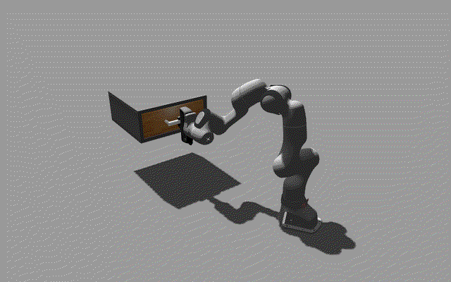 | 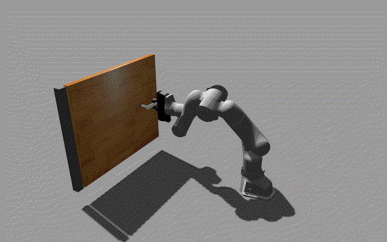 |

*Step 3, 2026-10-28.*
- **Grasp:** the FR3 starts with its gripper on the handle (IK) and is welded to it.
- **Motion:** it opens the mechanism by following the true path with the temporary joint hold controller.
- **Measurement:** the weld measures the force on the handle, **F**.

The operator and the shared-control loop arrive in steps 4–5.

---

## Contents

1. [Run the simulation (step by step)](#1-run-the-simulation-step-by-step)
2. [Project plan and status](#2-project-plan-and-status)
3. [Architecture](#3-architecture)
4. [Repository layout](#4-repository-layout)
5. [Packages](#5-packages)
6. [Helper scripts](#6-helper-scripts)
7. [Results](#7-results)
8. [Changes with respect to the paper](#8-changes-with-respect-to-the-paper)
9. [Known issues and fixes](#9-known-issues-and-fixes)
10. [Real hardware notes (step 8)](#10-real-hardware-notes-step-8)
11. [Changelog](#11-changelog)
12. [Objectives check and next steps](#12-objectives-check-and-next-steps)

---

## 1. Run the simulation (step by step)

In each code block, `# --- on the host ---` marks commands for a normal terminal
and `# --- inside the container ---` marks commands for the Docker container. Never
source ROS 2 on the host, and never source ROS 1 Noetic in the container.

### 1.1 One-time setup (already done on this laptop)

```bash
# --- on the host (normal terminal) ---
git clone --recurse-submodules https://github.com/nayon007/Shared-Control-Teleoperation.git ~/SCE_571_ws
bash ~/SCE_571_ws/scripts/setup_host_docker.sh   # Docker, NVIDIA toolkit, DualSense udev rule (sudo)
# log out and back in (docker group), then check the GPU inside Docker:
docker run --rm --gpus all ubuntu:22.04 nvidia-smi
cd ~/SCE_571_ws && docker compose build          # builds sce571/humble-dev (~3.9 GB, slow on a slow network)
```

### 1.2 Every session

```bash
# 1. allow the container to open windows (once per login)
# --- on the host (normal terminal) ---
xhost +local:docker

# 2. start the container (it keeps running in the background)
cd ~/SCE_571_ws && docker compose up -d

# 3. open a shell inside it (repeat in more terminals if needed; ROS is pre-sourced)
docker compose exec dev bash

# 4. build the workspace (first time, or after changing code)
# --- inside the container ---
cd ~/SCE_571_ws/ros2_ws && colcon build --symlink-install && source install/setup.bash

# 5. launch the simulation: FR3 with its gripper welded to the handle (step 3)
ros2 launch sc_gazebo sim.launch.py                       # drawer, axis towards the robot
ros2 launch sc_gazebo sim.launch.py yaw:=2.74             # drawer with a tilted axis
ros2 launch sc_gazebo sim.launch.py kind:=door radius:=0.6  # door
```

The terminal prints the computed start pose. After about 20 s it shows
`[sim_startup]: welded fr3_link7 to mech_moving` and then `simulation ready`.
The start-up sequence (§5.3) keeps the arm from sagging, and the gripper is
attached to the handle.

To try the system, run in a second terminal:

```bash
# --- inside the container ---
ros2 run sc_gazebo weld_check.py --demo      # the arm opens and closes the mechanism
ros2 run sc_gazebo weld_check.py             # full step 3 validation (§7.3)
```

**Phase 3 scenario and baseline.** Use this launch for trials (see §7.4):

```bash
# --- inside the container ---
ros2 launch sc_gazebo sim.launch.py ideal_gravity_comp:=true
ros2 run sc_gazebo baseline_direct.py --heading 2   # scripted operator, 2 deg heading error
ros2 run sc_gazebo baseline_direct.py --joy         # DualSense; needs `ros2 run joy joy_node`
```

**Controls (`--joy`, tested with simulated stick messages only, `scripts/fake_joy.py`):** left stick moves the hand in the base x/y plane (right = +x, up = +y), right stick up moves +z, and R2 sets the speed and acts as the deadman (released or untouched = no motion). Maximum speed is 0.1 m/s. The same success and failure criteria apply. Full steps for this scenario are in [README_PHASE3.md](README_PHASE3.md).

**Reset:** stop and relaunch, about 11 s. Every trial starts from this state.

```bash
# --- inside the container ---
bash ~/SCE_571_ws/scripts/stop_sim.sh      # then run the launch command again
# --- on the host (normal terminal) ---
bash ~/SCE_571_ws/scripts/run_sim_bg.sh gui:=false ideal_gravity_comp:=true   # same, from the host
```

**Launch arguments of `sim.launch.py`:**

| Argument | Default | Meaning |
|---|---|---|
| `kind` | `drawer` | `drawer` or `door` |
| `x y z yaw` | `0.7 0 0.4 3.14159` | pose of the handle at q = 0; +x of this frame is the opening direction, so `yaw` randomises the axis (π = towards the robot). See §7.3 for the reachable range |
| `radius` | `0.6` | door: hinge to handle [m] |
| `damping` | `5.0` | joint damping [Ns/m or Nms/rad] |
| `friction` | `3.0` | joint Coulomb friction [N or Nm] |
| `mass` | `2.0` | drawer / door leaf mass [kg] |
| `stroke` | 0.28 m / 0.75 rad | opening the start pose must be able to follow (trial target 0.25 m of handle travel, plus margin) |
| `weld` | `true` | attach the gripper to the handle after start-up |
| `ideal_gravity_comp` | `false` | no gravity on the robot links, modelling τ_g of Eq. 7; used for all Phase 3 trials |
| `robot_type` | `fr3` | `fr3`, `fr3v2` or `fr3v2_1` (must match the lab robot for hardware) |
| `gui` | `true` | `false` for headless runs |

`ros2 launch sc_description gazebo.launch.py` (step 2) still starts the scene
without the weld, with the arm in the Franka "ready" pose. It also accepts
`paused:=true` for inspecting models.

### 1.3 Useful checks (second container terminal)

```bash
# --- inside the container ---
ros2 control list_controllers              # joint_state_broadcaster, gripper_controller, arm_hold_controller
ros2 topic echo /sc_weld/handle_wrench      # F (and torque) of the robot on the handle, world frame, 500 Hz
ros2 topic echo /sc_weld/attached           # true while welded
ros2 service call /sc_weld/detach std_srvs/srv/Trigger   # let go of the handle (attach: /sc_weld/attach)
ros2 topic echo /mechanism/joint_states    # ground-truth q of the drawer/door (logger only!)
ros2 topic echo /joint_states              # FR3 joints
ros2 run rqt_image_view rqt_image_view /scene_camera/image_raw   # operator view

# push the mechanism with 10 N, then remove the push again (efforts add up, see §9);
# while welded, /sc_weld/handle_wrench shows the arm resisting the push
ros2 service call /apply_joint_effort gazebo_msgs/srv/ApplyJointEffort \
             "{joint_name: mechanism::mech_joint, effort: 10.0, duration: {sec: -1}}"
ros2 service call /apply_joint_effort gazebo_msgs/srv/ApplyJointEffort \
             "{joint_name: mechanism::mech_joint, effort: -10.0, duration: {sec: -1}}"
```

**Models only, in RViz (no physics):** drag the sliders to move the arm and the drawer or door.

```bash
# --- inside the container ---
ros2 launch sc_description view.launch.py              # or kind:=door
```

### 1.4 Stop

```bash
# --- inside the container ---
bash ~/SCE_571_ws/scripts/stop_sim.sh    # or Ctrl-C in the launch terminal
# --- on the host (normal terminal) ---
docker compose down                           # stop the container (files stay on the host)
```

Always stop the old simulation before you launch a new one. Leftover
processes publish a stale robot model that the next launch would spawn
(see §9).

### 1.5 Tests

```bash
# --- inside the container ---
cd ~/SCE_571_ws/ros2_ws && colcon test --packages-select sc_core sc_description sc_gazebo && colcon test-result --verbose
bash ~/SCE_571_ws/scripts/smoke_gazebo.sh [kind:=door]   # step 2 scene, headless check
# --- on the host (normal terminal) ---
bash ~/SCE_571_ws/scripts/run_sim_bg.sh gui:=false       # step 3 sim headless, waits for /sim_ready
# --- inside the container ---
ros2 run sc_gazebo weld_check.py --seconds 10            # then the step 3 validation
ros2 run sc_gazebo reachability.py --markdown            # workspace table of §7.3 (~25 min)
# --- on the host (normal terminal) ---
cd ~/SCE_571_ws/ros2_ws/src/sc_core && python3 -m unittest discover -s test   # core only, no ROS
```

### 1.6 Regenerate the images and GIFs in this README

```bash
# --- on the host (normal terminal) ---
bash ~/SCE_571_ws/scripts/run_pilot.sh        # all 48 pilot trials (~20 min, resumes; container up)
python3 ~/SCE_571_ws/scripts/analyze_pilot.py # tables and plots from the trial files
bash ~/SCE_571_ws/scripts/capture_step3.sh    # step 3 GIFs and images (container must be up)
bash ~/SCE_571_ws/scripts/capture_scenes.sh   # step 2 images and GIFs
```

---

## 2. Project plan and status

| # | Step | Where | Status |
|---|------|-------|--------|
| 0a | Host setup: Docker Engine, NVIDIA Container Toolkit, DualSense udev rule | [scripts/setup_host_docker.sh](scripts/setup_host_docker.sh) | ✅ done (Docker 28.1, NVIDIA runtime) |
| 0b | Dev container: Humble, Gazebo 11, `ros2_control`, joy, pydualsense; GPU, X11, devices, host network | [docker/Dockerfile](docker/Dockerfile), [compose.yaml](compose.yaml) | ✅ done (`sce571/humble-dev`, RTX 4090 visible inside) |
| 1 | Core algorithms (estimator, fixture, haptics, mapping, metrics), offline closed-loop simulator, tests | [ros2_ws/src/sc_core](ros2_ws/src/sc_core) | ✅ done |
| 2 | FR3 + hand with `ros2_control` for Gazebo; drawer / door model; world; scene camera; launch files; temporary joint hold | [ros2_ws/src/sc_description](ros2_ws/src/sc_description) | ✅ done; 5 tests, headless smoke test, GUI images and GIFs above |
| 3 | Start pose with the gripper on the handle (IK in `sc_core`); weld plugin (fixed joint hand ↔ `mech_moving`) publishing the handle wrench **F**; deterministic start-up; validation, reachability study | [ros2_ws/src/sc_gazebo](ros2_ws/src/sc_gazebo) | ✅ done; all checks pass for drawer and door (§7.3) |
| P3 | Course Phase 3: scenario specification, direct teleoperation baseline, reset, 48 pilot trials, report | [docs/phase3_report](docs/phase3_report), `baseline_direct.py`, [results/phase3](results/phase3) | ✅ done (§7.4); DualSense input untested |
| 4 | Cartesian impedance controller τ = Jᵀ(K e − D ẋ) + null-space posture and joint-limit terms (+ optional KDL gravity), as a C++ `ros2_control` controller on the effort interfaces; Lyapunov stability argument; takes over from the joint hold after the weld | [sc_control](ros2_ws/src/sc_control) | ✅ done (§5.4) |
| 5 | Shared-control node (100 Hz, `sc_core` estimator, fixture, haptics, metrics), DualSense haptics (pydualsense), keyboard input with haptic display, trial logging | [sc_teleop](ros2_ws/src/sc_teleop) | ✅ done; DualSense on USB connected 2026-11-25 (input verified) |
| 6 | One launch file for direct / assisted runs with keyboard, DualSense or scripted operator; parameter YAML | `sc_teleop/launch/teleop.launch.py`, `config/shared_control.yaml` | ✅ done |
| 7 | Experiments: scripted direct vs assisted trials, drawer (3 axes) and door, metrics and plots | `run_experiments.sh`, `analyze_step7.py`, [results/step7](results/step7) | ✅ done (§7.5) |
| 8 | Real hardware: controller and helper configuration for `franka_ros2`, Franka wrench relay, hardware launch | `sc_teleop/launch/hardware.launch.py`, `config/fr3_hardware.yaml` | 🟡 written, **not tested on a robot** (§10) |

**Open decisions:**
- **Keep `perp_leak` for the trials** (see §7.1)? Recommended: yes.
- **Which FR3 variant does the lab have**, and which system-image version?

---

## 3. Architecture

*Source: Sec. 3 of the paper ([main.pdf](LaTeX_Literature_Review/main.pdf)).*

### 3.1 Problem

Once the gripper holds the handle, the arm and the mechanism form a closed
kinematic chain. Only motion along the mechanism's path is admissible. Any
commanded motion in another direction turns into internal force at the handle,
large enough to damage hardware, pull the handle out of the gripper or trip the
robot's safety limits. An operator using a gamepad cannot feel these forces and
does not know in advance which way the mechanism moves.

The control problem is therefore *compliant manipulation under an unknown
kinematic constraint, avoiding forces perpendicular to the permitted motion*.

The approach combines two ideas:
- **The online tangent estimator of Lutscher et al. (2010)**, which reads the permitted direction from the robot's own compliant motion.
- **A guidance virtual fixture (Marayong et al. 2003)**, which filters the operator's command by projecting it onto that direction.

The study compares **direct** control (the command passes unchanged) with
**assisted** control (the command is projected onto the estimated tangent).
Both modes give identical haptic feedback, so differences in opening time,
off-axis force, handle loss and opening distance can be attributed to the
assistance itself.

### 3.2 Block diagram


*Fig. 1 of the paper.*
- **Direct control:** block 4 passes the operator command through unchanged.
- **Assisted control:** block 4 projects the command onto the estimated tangent d̂ supplied by block 7.
- **Feedback channels:** the operator receives the rendered scene (dashed grey) and the DualSense haptics (red).
- **Ground truth:** the true joint coordinate q reaches only the logger, never the controller or the estimator.

*Note:* the paper's block 6 reads "Franka Panda + MuJoCo / robosuite". In this
project it is the **FR3 in Gazebo Classic**, and later the real FR3 (see §8).

| # | Block | Function | Outputs | Implemented in |
|---|---|---|---|---|
| 1 | Human operator | Chooses the target, judges progress from the rendered scene, reacts to haptic cues | thumb and finger motion | — |
| 2 | DualSense input | Left stick: planar direction. Right stick: vertical. R2 depression g ∈ [0,1]: speed scale and deadman | stick axes **a**, throttle g | `joy` (step 5) |
| 3 | Teleop mapping | Dead-zone, speed limit v_max, rotation from the viewing frame to the base frame | **u** = g·v_max·**R**·φ(**a**) | `sc_core.teleop_mapping` ✅ |
| 4 | Assistance | Passes **u** unchanged (direct) or applies the confidence-weighted guidance fixture (assisted) | **v**_c | `sc_core.assistance` ✅ |
| 5 | Cartesian impedance / OSC | Integrates **v**_c into a desired pose and tracks it compliantly, so the mechanism can deflect the end-effector | joint torques **τ** | `sc_control` (step 4) |
| 6 | Robot + mechanism | Arm, welded grasp, prismatic drawer or revolute door with friction and damping; axis randomised per trial | **p**, **ṗ**, **F**; ground truth q | `sc_description` ✅ + weld (step 3) |
| 7 | Constraint estimator | Filtered, gated and sign-aligned tangent estimate; splits the wrench into along-path and off-axis parts | d̂, c, F∥, **F**⊥ | `sc_core.estimator`, `sc_core.haptics` ✅ |
| 8 | Haptic mapping | Off-axis force and rejected command → rumble r; along-path force → trigger resistance ρ | r, ρ ∈ [0,1] | `sc_core.haptics` ✅ |
| 9 | DualSense actuators | Rumble motors and R2 adaptive trigger | vibration, trigger force | `pydualsense` (step 5) |
| 10 | Visual display | Rendered view of robot and mechanism, identical in both modes | visual feedback | scene camera `/scene_camera/image_raw` ✅ |
| 11 | Logger & metrics | Records all signals; computes opening time, off-axis force, handle-loss events, opening distance | time series, metrics | `sc_core.metrics` ✅ + logger (step 5) |

### 3.3 Control laws (paper Eqs. 3–8)

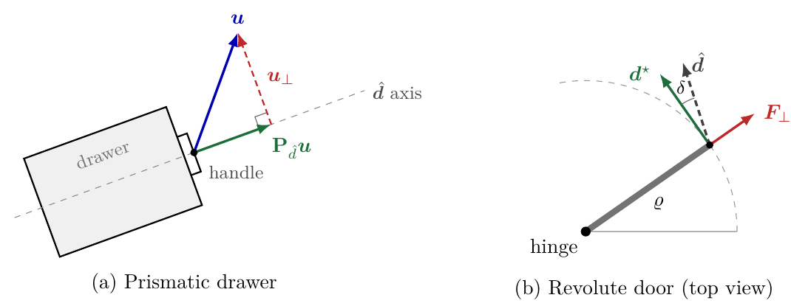

*Fig. 2 of the paper.*
- **(a) Drawer:** the operator command **u** is split into the part along the estimated axis, which is executed, and the rejected part **u**⊥, which is removed in assisted mode and reported by vibration.
- **(b) Door:** the true tangent **d**\* rotates as the door opens. The filtered estimate d̂ trails it by a small angle δ, so a small radial force **F**⊥ remains and is absorbed by the controller's compliance.

**Force split** (Eq. 3). F is the force applied by the robot to the handle:

```
F∥ = d̂ᵀ F        F⊥ = (I − d̂ d̂ᵀ) F        u⊥ = (I − d̂ d̂ᵀ) u
```

**Constraint estimator** (Eq. 4). This is the Lutscher et al. (2010) estimator
with three additions: a speed gate, sign alignment and a confidence measure.

```
v̄_k = (1−β) v̄_{k−1} + β ṗ_k
if ‖v̄_k‖ > v_min:   m_k = v̄_k/‖v̄_k‖,  flipped if m_kᵀ d̂_{k−1} < 0,  pushed into a window W of N samples
d̂_k = Σ_W m / ‖Σ_W m‖          c_k = ‖Σ_W m‖ / N  ∈ [0, 1]
```

**Door lag** (Eq. 5): δ ≈ ‖ṗ‖ T_f / ϱ. For example, 0.1 m/s, ϱ = 0.5 m and T_f = 0.2 s give δ ≈ 0.04 rad.

**Assistance: confidence-weighted guidance fixture** (Eq. 6):

```
v_c = [ P + k⊥(c) (I − P) ] u ,   P = d̂ d̂ᵀ ,   k⊥(c) = 1 − (1 − k_min) · sat_[0,1]( (c − c0) / (c1 − c0) )
```

While c ≤ c0, the operator keeps full authority (the start-up phase). As the
samples align, k⊥ falls to k_min (0.05), and the fixture becomes effectively hard.

**Low-level control: operational-space impedance** (Eq. 7):

```
x_d ← x_d + Δt v_c
τ = Jᵀ Λ [ K_p (x_d − x) − K_d ẋ ] + τ_g + τ_null
```

With the handle constrained, x_d − x can grow only in the blocked directions,
and the force on the mechanism is about K_p times that error. That is why the
lateral command must be removed at its source.

**Haptic feedback** (Eq. 8):

```
r = sat_[0,1]( (‖F⊥‖ − F0)/(F1 − F0) + κ_u ‖u⊥‖ / v_max )        ρ = sat_[0,1]( (|F∥| − F∥0)/(F∥1 − F∥0) )
```

All parameters, with their paper symbols and defaults, are in
[`sc_core/params.py`](ros2_ws/src/sc_core/sc_core/params.py). One cycle of the
loop (paper Algorithm 1) is implemented in
[`sc_core/offline_sim.py`](ros2_ws/src/sc_core/sc_core/offline_sim.py) and will
run in the step 5 shared-control node.

### 3.4 Software mapping

```
 DualSense ──joy──► teleop mapping ──u──► assistance ──v_c──► set-point ──x_d──► Cartesian impedance ──τ──► FR3 + drawer/door
   ▲   (block 2)        (3)              (4)  ▲              integration      controller (5)              (Gazebo / real)
   │                                          │ d̂, c                                                       (6)
   │                                    constraint estimator (7) ◄─────────── p, ṗ, F (handle) ────────────┘
   │                                          │ F⊥, F∥, u⊥
   └── rumble r, trigger ρ ◄── haptic mapping (8)                 logger & metrics (11) ◄── all signals + true q
   scene camera (10) ──► operator
```

Blocks 3, 4, 7, 8 and 11 live in the ROS-independent `sc_core` library, so the
same code runs in the offline simulator, in Gazebo and on the robot. Only
blocks 5 and 6 differ between simulation and hardware.

**Design rule:** the controller uses only the standard `ros2_control` interfaces,
and the teleop nodes use only standard messages (`geometry_msgs`,
`sensor_msgs/Joy`). Switching from Gazebo to the real FR3 is then a launch-file
change.

**Interfaces available so far:**

| Topic / service | Type | Source |
|---|---|---|
| `/joint_states` | `sensor_msgs/JointState` | joint_state_broadcaster (FR3 arm + fingers) |
| `/mechanism/joint_states` | `sensor_msgs/JointState` | Gazebo; ground truth q, **logger only** |
| `/robot_description`, `/mechanism/robot_description` | `std_msgs/String` | robot_state_publisher |
| `/scene_camera/image_raw` | `sensor_msgs/Image` 1280×800 @ 15 Hz | operator view (block 10) |
| `/arm_hold_controller/joint_trajectory` | `trajectory_msgs/JointTrajectory` | joint hold (start-up and Phase 3 baseline) |
| `/cartesian_impedance_controller/target_pose` | `geometry_msgs/PoseStamped`, frame `fr3_link0` | set-point x_d of the impedance controller (step 4) |
| `/cartesian_impedance_controller/current_pose`, `current_twist` | `geometry_msgs/PoseStamped`, `TwistStamped`, 100 Hz | gripper pose p and twist ṗ (from KDL) |
| `/joy` | `sensor_msgs/Joy` | DualSense (`joy_node`) or `keyboard_joy.py` |
| `/sc/haptics` | `std_msgs/Float32MultiArray` | [r, ρ, c, F∥, ‖F⊥‖] from `shared_control` |
| `/sc/status` | `std_msgs/Float32MultiArray`, 100 Hz | t, opening, true ‖F⊥‖ and F∥, estimated ‖F⊥‖, c, r, ρ, u, v_c, mode (`STATUS_FIELDS`) for the recorder |
| `/gripper_controller/commands` | `std_msgs/Float64MultiArray` | finger opening [m] |
| `/apply_joint_effort` | `gazebo_msgs/srv/ApplyJointEffort` | test pushes on `mechanism::mech_joint` |
| `/sc_weld/handle_wrench` | `geometry_msgs/WrenchStamped`, 500 Hz, best effort | **F**: force of the robot on the handle [N], world (= FR3 base) frame; torque [Nm] about the `mech_moving` origin (drawer: grasp point at q = 0; door: hinge) |
| `/sc_weld/attached` | `std_msgs/Bool`, transient local | weld state |
| `/sc_weld/attach`, `/sc_weld/detach` | `std_srvs/srv/Trigger` | close / open the weld |
| `/sim_ready` | `std_msgs/Bool`, transient local | true once the start-up sequence has finished |

---

## 4. Repository layout

```
SCE_571_ws/                               (mounted in the container at /home/dev/SCE_571_ws)
├── README.md                             ← this file (updated after every step)
├── compose.yaml                          ← dev container (GPU, X11, /dev, host network, RT limits)
├── docker/Dockerfile                     ← ROS 2 Humble + Gazebo 11 image
├── .dockerignore
├── LaTeX_Literature_Review/              ← paper / design document (main.tex, references.bib, main.pdf)
├── docs/figures/                         ← figures taken from the paper (architecture, assistance geometry)
├── scripts/                              ← helper scripts (§6)
├── results/
│   ├── offline_sim.png, offline_sim_leak2.png   ← step 1 figures
│   ├── step3_{drawer,door}.{png,json,_on.csv,_off.csv}  ← step 3 validation (weld_check.py)
│   └── images/                           ← Gazebo images and GIFs (steps 2 and 3)
└── ros2_ws/src/
    ├── franka_description/               ← git submodule: official FR3 model, pinned to tag 2.9.0 (do not edit)
    ├── sc_core/                          ← step 1: algorithms (pure Python, no ROS dependency)
    ├── sc_description/                   ← step 2: models, world, camera, launch
    ├── sc_gazebo/                        ← step 3: weld plugin, start pose, start-up, checks
    ├── sc_control/                       ← step 4: Cartesian impedance controller (C++ ros2_control plugin)
    └── sc_teleop/                        ← steps 5, 6, 8: shared-control node, haptics, launch files
```

---

## 5. Packages

### 5.1 `sc_core` (step 1, ament_python, no ROS dependency)

| Module | Paper | Content |
|---|---|---|
| `params.py` | Alg. 1 | all tunable parameters, named with paper symbols |
| `estimator.py` | Eq. 4 | low-pass filter, speed gate, sign alignment, window of N samples, confidence c |
| `assistance.py` | Eq. 6 | k⊥(c), projection P = d̂d̂ᵀ, set-point integration (+ optional `perp_leak`) |
| `haptics.py` | Eqs. 3 and 8 | F∥/F⊥ split, rumble r, trigger ρ (F = force applied by the robot to the handle) |
| `teleop_mapping.py` | block 3 | stick dead-zone, scaling, view→base rotation |
| `mechanisms.py` | Sec. 3.2 | ground-truth prismatic / revolute paths (evaluation only) |
| `metrics.py` | block 11 | opening time, off-axis force (true tangent), handle loss, distance |
| `offline_sim.py` | Alg. 1 | closed-loop numpy simulation, direct vs assisted |
| `kinematics.py` | Eq. 7 (J) | serial chain from a URDF string: forward kinematics, geometric Jacobian, damped-least-squares pose IK with joint limits, random restarts (step 3) |
| `grasp.py` | Sec. 3.2 | handle pose and true tangent d*(q) along the drawer / door path, matching the URDF; grasp orientation; `solve_grasp` and `follow_path` (step 3) |

### 5.2 `sc_description` (step 2, ament_cmake)

| File | Content |
|---|---|
| `urdf/fr3_sc.urdf.xacro` | FR3 + Franka Hand from `franka_description`. `sim_gazebo:=true` adds `ros2_control` (`gazebo_ros2_control/GazeboSystem`): 7 arm joints with **effort** commands, plus fingers with position commands (joint 2 mimics joint 1) |
| `urdf/mechanism.urdf.xacro` | `kind:=drawer` (prismatic, 0–0.35 m, 0.40×0.40×0.15 m drawer in an open carcass) or `kind:=door` (revolute about −z at `radius`, 0–90°, 0.60 m tall leaf). Links: `mech_base` (fixed), `mech_moving` (weld target in step 3), `mech_handle` (visual only). Publishes ground truth on `/mechanism/joint_states` |
| `config/initial_positions.yaml` | default start configuration (Franka "ready" pose); `sim.launch.py` replaces it with the IK start pose |
| `config/ros2_controllers.yaml` | 1 kHz controller manager: `joint_state_broadcaster`, `gripper_controller`, `arm_hold_controller` (temporary PID hold through the effort interfaces) |
| `worlds/sc_empty.world` | ODE, 1 ms step, real-time factor 1 |
| `models/scene_camera/model.sdf` | fixed 1280×800 camera on `/scene_camera/image_raw` (operator view, block 10) |
| `launch/gazebo.launch.py` | world + FR3 + mechanism + camera + controllers + `go_to_start.py`; arguments `world`, `initial_positions_file`, `controllers` let `sim.launch.py` reuse it |
| `launch/view.launch.py` | RViz with joint sliders, no physics |
| `scripts/go_to_start.py` | sends the arm to `initial_positions.yaml` through `arm_hold_controller` |
| `test/test_xacro.py` | models expand; `ros2_control` tags present; drawer and door open along +x of the mechanism frame |

**Mechanism frame convention:** `mech_base` sits at the grasp point on the
closed handle (q = 0), and +x is the opening direction there. The defaults put
the handle 0.7 m in front of the robot at a height of 0.4 m, opening towards
it. Randomising `yaw` around π randomises the axis, as the paper requires.

### 5.3 `sc_gazebo` (step 3, ament_cmake)

| File | Content |
|---|---|
| `src/weld_plugin.cpp` | Gazebo world plugin `libsc_weld_plugin.so`. On `/sc_weld/attach` it creates a fixed joint between `fr3_link7` (Gazebo lumps link 8, the hand and the TCP into link 7) and `mech_moving` at their current relative pose. It publishes the joint's wrench as **F** on `/sc_weld/handle_wrench`. The optional `break_force` opens the weld above a threshold (default off: the paper only *registers* handle loss) |
| `worlds/sc_weld.world` | `sc_empty.world` + the weld plugin |
| `launch/sim.launch.py` | computes the start pose, then starts `sc_description/gazebo.launch.py` paused with that pose and this world, plus `sim_startup.py` |
| `scripts/sim_startup.py` | start-up sequence (below) |
| `scripts/weld_check.py` | step 3 validation (§7.3); `--demo` only opens and closes the mechanism |
| `scripts/baseline_direct.py` | Phase 3 baseline: direct teleoperation (v_c = u) through IK and the joint controller, scripted or DualSense; applies the success and failure criteria |
| `scripts/reachability.py` | workspace study (§7.3) |
| `test/test_start_pose.py` | FR3 forward kinematics against the known "ready" pose; IK grasp and full stroke for the default drawer (straight and ±0.4 rad) and door |

**Start pose.** The handle pose at q = 0 is placed in front of the FR3:
- **Grasp:** the approach axis points into the mechanism, and the fingers close vertically around the horizontal bar.
- **Search:** `solve_grasp` collects IK solutions for both symmetric hand orientations, from the "ready" pose and from 20 random starts each.
- **Ranking:**
  1. how far the solution can follow the opening path continuously (`stroke`);
  2. distance to the "ready" pose, which gives a natural posture so the arm does not swing round through the mechanism;
  3. joint-limit margin.

**Start-up sequence** (`sim_startup.py`):
1. Gazebo starts **paused**, with the FR3 already in the start pose.
2. The controllers are loaded and configured.
3. Physics is unpaused and the controllers are activated in one switch, so the arm has no time to sag.
4. The arm holds the start pose to within 2 mrad (about 1.5 mm at the TCP).
5. The weld closes, and the hold is re-commanded to the configuration actually welded, so nothing pre-loads the weld.
6. `/sim_ready` becomes true.

---

### 5.4 `sc_control` (step 4, ament_cmake, C++)

`sc_control/CartesianImpedanceController`, a `ros2_control` controller on the seven effort interfaces, running at 1 kHz:

```
τ = Jᵀ (K e − D ẋ) + N (k_n (q_n − q) + τ_lim − d_n q̇) [+ τ_g]
N = I − Jᵀ (J Jᵀ + λ² I)⁻¹ J
```

| Symbol | Meaning | Simulation value |
|---|---|---|
| e | pose error of `fr3_hand_tcp`: position, and rotation vector of R_d Rᵀ; the position part is capped at 0.10 m, the rotation part at 0.3 rad | |
| ẋ = J q̇ | gripper twist (KDL Jacobian in the base frame) | |
| K | stiffness, diagonal | 600 N/m, 30 Nm/rad |
| D | damping, diagonal | 50 N·s/m, 2 N·m·s/rad |
| N | null-space projector of the redundant joint (damped, λ = 0.05) | |
| k_n, d_n, q_n | elbow posture spring and damping, towards the configuration at activation | 2 Nm/rad, 1 N·m·s/rad |
| τ_lim | joint-limit repulsion, −∇ of ½ k_lim Σ max(0, margin − distance)² | margin 0.3 rad, k_lim 30 Nm/rad |
| τ_g | KDL gravity torque, only when the simulator applies gravity to the arm (`ideal_gravity_comp:=false`); off on the real FR3, where libfranka adds it | off |

Torques are rate-limited to 1 Nm per cycle (as the FR3 requires) and clipped to the joint torque limits. The set-point arrives on `~/target_pose`; on activation it starts at the current pose, so switching from the joint hold does not move the arm. The controller is loaded by `sim_startup.py` when `sim.launch.py` gets `controller:=impedance`; it reads the URDF from the latched `/robot_description` topic.

**Stability (Lyapunov).** With gravity compensated and a fixed set-point, take the energy V = ½ q̇ᵀ M(q) q̇ + ½ eᵀ K e ≥ 0. Using the robot dynamics M q̈ + C q̇ + g = τ + Jᵀ F_env and the skew symmetry of Ṁ − 2C:

```
V̇ = q̇ᵀ (τ − g) − ẋᵀ K e + q̇ᵀ Jᵀ F_env = −ẋᵀ D ẋ − q̇ᵀ N d_n q̇ + ẋᵀ F_env
```

Without contact, V̇ ≤ 0 for any positive K and D, and the arm comes to rest at the set-point (LaSalle). In contact with a passive mechanism (friction and damping only take energy out), the closed loop stays passive and therefore stable. The posture spring and τ_lim act through the projector N, which is why they appear here only approximately; they are small and did not affect stability in any run. The paper's Eq. 7 uses JᵀΛ[…] (operational-space inertia shaping); this project uses the simpler Jᵀ[…] form, whose stability proof needs neither Λ nor Coriolis compensation (Takegaki and Arimoto 1981).

### 5.5 `sc_teleop` (steps 5, 6 and 8, ament_python)

| File | Content |
|---|---|
| `sc_teleop/shared_control.py` | the shared-control loop (paper Alg. 1) at 100 Hz of simulation time: operator command from `/joy` or a scripted operator → estimator → direct or assisted fixture → off-axis leak → `target_pose`; haptics on `/sc/haptics`; trial check, metrics JSON and time-series CSV. The orientation target follows the measured yaw, so the wrist turns freely with a door |
| `sc_teleop/session_recorder.py` | records a session: `video.mp4` (scene camera with the live numbers drawn on), `data.csv` from `/sc/status`, `summary.json` with the session metrics |
| `sc_teleop/dualsense_haptics.py` | `/sc/haptics` → rumble motors (r) and the R2 adaptive trigger in rigid mode (ρ), with pydualsense |
| `sc_teleop/franka_wrench_relay.py` | step 8: Franka's `o_f_ext_hat_k` → `/sc/external_wrench` |
| `launch/teleop.launch.py` | everything in one command: simulation with the impedance controller, `shared_control`, and for `input:=dualsense` also `joy_node` and the haptics |
| `launch/hardware.launch.py` | step 8: controller spawner into `franka_ros2`, relay, `shared_control`, `joy_node`, haptics |
| `config/shared_control.yaml` | estimator, fixture, haptics and trial parameters; `perp_leak` 2/s (assisted only) |
| `config/fr3_hardware.yaml` | step 8 gains (softer), wrench source and sign |
| `test/test_shared_control.py` | quaternion conversion and DualSense mapping |

## 6. Helper scripts

| Script | Where to run | Purpose |
|---|---|---|
| [scripts/setup_host_docker.sh](scripts/setup_host_docker.sh) | host, once | Docker, NVIDIA Container Toolkit, DualSense udev rule |
| [scripts/stop_sim.sh](scripts/stop_sim.sh) | container | stop every simulation process |
| [scripts/smoke_gazebo.sh](scripts/smoke_gazebo.sh) | container | headless check: controllers, interfaces, joint states, errors |
| [scripts/snapshot.py](scripts/snapshot.py) | container | save one scene-camera frame as PNG |
| [scripts/record_gif.py](scripts/record_gif.py) | container | record the scene camera as a GIF, optionally pushing the mechanism (`--effort`) |
| [scripts/screenshot.sh](scripts/screenshot.sh) + [xwd2png.py](scripts/xwd2png.py) | host | screenshot of a window by title (e.g. Gazebo) |
| [scripts/run_sim_bg.sh](scripts/run_sim_bg.sh) | host | start `sim.launch.py` in the container in the background and wait for `/sim_ready` |
| [scripts/run_pilot.sh](scripts/run_pilot.sh) | host | Phase 3 pilot trials, each from a full reset |
| [scripts/analyze_pilot.py](scripts/analyze_pilot.py) | host | pilot summary, table and plots |
| [scripts/capture_step3.sh](scripts/capture_step3.sh) | host | step 3 images and GIFs |
| [scripts/keyboard_joy.py](scripts/keyboard_joy.py) | container | drive with the keyboard (publishes `/joy`); shows rumble and trigger bars |
| [scripts/run_teleop_trial.sh](scripts/run_teleop_trial.sh) | host | one scripted shared-control trial in a fresh simulation |
| [scripts/run_experiments.sh](scripts/run_experiments.sh) | host | step 7 trials (resumable) |
| [scripts/analyze_step7.py](scripts/analyze_step7.py) | host | step 7 table and plots |
| [scripts/drive.sh](scripts/drive.sh) | host | start / stop a recorded DualSense session (`drive.sh assisted 3`, `drive.sh stop`) |
| [scripts/analyze_sessions.py](scripts/analyze_sessions.py) | host | table, plots and H.264 videos of recorded sessions |
| [scripts/run_friction_study.sh](scripts/run_friction_study.sh) + [analyze_friction.py](scripts/analyze_friction.py) | host | friction study (§7.6) |
| [scripts/make_grid_video.py](scripts/make_grid_video.py) | host | 2 or 4 session videos side by side |
| [scripts/make_session_figures.py](scripts/make_session_figures.py) | host | direct vs assisted figures, plus camera-and-live-plot videos and GIFs of the human sessions |
| [scripts/capture_scenes.sh](scripts/capture_scenes.sh) | host | step 2 images and GIFs |

---

## 7. Results

### 7.1 Offline simulator (step 1)

**Setup:**
- **End-effector model:** a point mass welded to the handle, under Cartesian impedance with Kp = 400 N/m and Kd = 40 Ns/m.
- **Mechanism:** 3 kg effective mass, 5 Ns/m damping, 3 N Coulomb friction.
- **Rates:** physics at 1 kHz, control at 100 Hz.
- **Simulated operator:** pushes at 0.1 m/s along a fixed direction 20° off the true initial tangent, until the handle has travelled 0.25 m.
- **Handle loss:** counted when the true |F⊥| exceeds 30 N.
- **Scenarios:** 5 drawers with random axes, and 3 doors (r = 0.4, 0.6 and 0.8 m).

| Scenario | Mode | mean \|F⊥\| [N] | peak \|F⊥\| [N] | handle lost |
|---|---|---|---|---|
| drawers (5) | direct | 15.1 | 30.1 | **5/5** |
| drawers (5) | assisted, paper baseline | 8.7 – 9.3 | 9.0 – 9.7 | 0/5 |
| drawers (5) | assisted + set-point leak 2 s⁻¹ | **0.5** | 7.9 | 0/5 |
| door r = 0.6 | direct | 12.8 | 14.6 | no |
| door r = 0.6 | assisted, paper baseline | 1.6 | 6.8 | no |
| door r = 0.6 | assisted + set-point leak 2 s⁻¹ | **0.6** | 6.8 | no |

Opening time changes by less than 0.15 s between modes (about 2.6–2.9 s).
Reproduce with `python3 -m sc_core.offline_sim [--perp-leak 2.0] [--plot file.png]`.

| Paper baseline | With set-point leak 2 s⁻¹ |
|---|---|
| 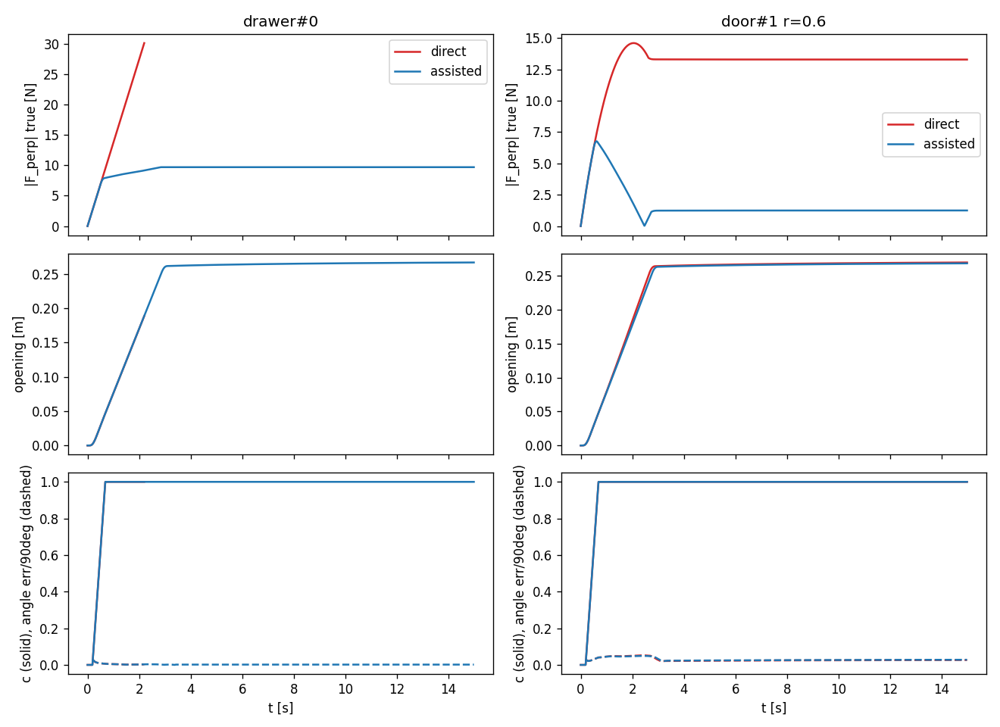 | 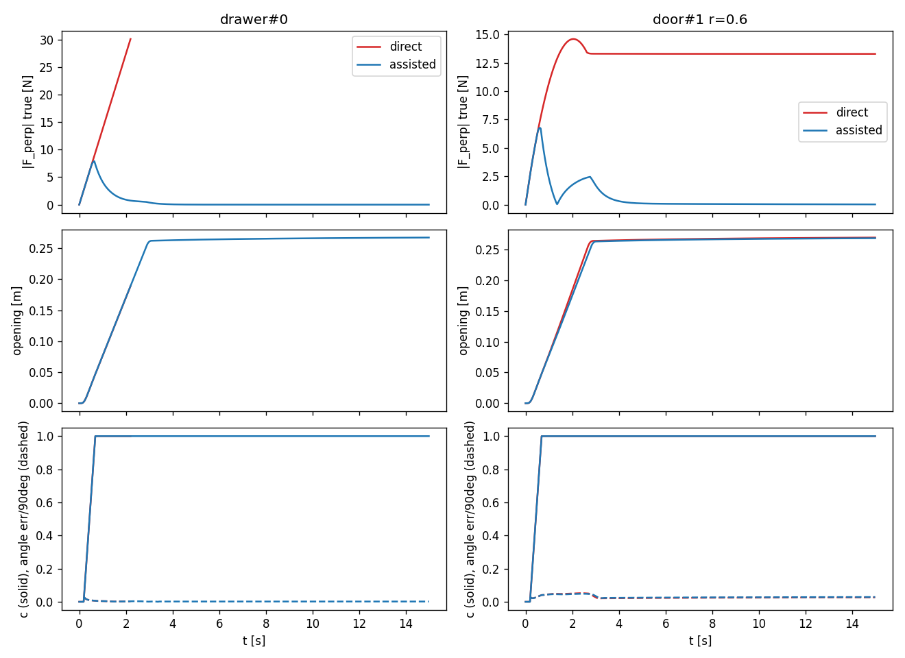 |

**Finding 1: start-up residual (not discussed in the paper).**
- **What happens:** the fixture engages only once confidence reaches c₁, about 0.6 s after the start (N = 50 at 100 Hz). Off-axis set-point error that builds up before then is never removed, because x_d ← x_d + Δt·v_cmd has no restoring term. On a drawer this leaves about 9 N of permanent side force.
- **Fix:** `Params.perp_leak` (`integrate_setpoint` in `assistance.py`). Once c ≥ c₁, it decays the off-axis part of (x_d − x), following the set-point-generator idea of Lutscher & Cheng 2012.
- **Default:** 0, the paper baseline.

**Finding 2: door lag.** On doors the estimate trails the true tangent by
about 2–3° for r = 0.6 m, as Eq. 5 predicts.

**Simplifications** that Gazebo removes:
- There are no arm dynamics.
- The grasp is perfectly rigid.
- The door has no centripetal coupling.
- The operator is open-loop.

### 7.2 Gazebo models (step 2)

| Check | Result |
|---|---|
| Unit tests (`colcon test`) | all pass (see §7.3 for the current count) |
| Spawn FR3 + drawer / FR3 + door | ✅ both, real-time factor 1.00 with GUI on the RTX 4090 |
| Controllers | `joint_state_broadcaster`, `gripper_controller` and `arm_hold_controller` active; 7 arm effort interfaces available for step 4 |
| Start pose after `go_to_start.py` | within about 4 mrad of q₀ = (0, −0.785, 0, −2.356, 0, 1.571, 0.785) |
| Finger hold | 0.020 m |
| Mechanism physics (friction 0, 0.5 N push) | 0.062 m in 1 s; expected about 0.06 m for m = 2.1 kg and b = 5 Ns/m ✅ |
| Drawer, 4 N vs 3 N friction | opens fully to 0.35 m (GIF above) |
| Door, 5 Nm vs 3 Nm friction | opens about its hinge (GIF above) |

Gazebo window (drawer scene):


### 7.3 Welded grasp and handle wrench (step 3)

Run with `weld_check.py --seconds 10` on the default scenes (handle at x = 0.7, z = 0.4, friction 3 N / 3 Nm):
1. **Wrench:** push the mechanism with 10 N (drawer) or 10 Nm (door) while the arm holds still.
2. **On-axis:** drive the arm along the true path (0.20 m or 0.60 rad).
3. **Off-axis:** drive the same path with a horizontal error growing to 10 mm.

F∥ and F⊥ use the ground-truth tangent d*(q).

| Check | Drawer | Door (r = 0.6 m) |
|---|---|---|
| Unit tests | 33 test cases pass: 23 `sc_core`, 5 `sc_description`, 5 `sc_gazebo` | |
| TCP on the handle after start-up | 1.4 mm ✅ | 1.4 mm ✅ |
| Wrench for a 10 N / 10 Nm push | F along the axis = **−10.6 N** (expected −10 … −7 N, friction may carry up to 3 N) ✅ | moment about the hinge = **−6.7 Nm** (expected −10 … −7 Nm) ✅ |
| Closed chain: arm driven along the path | the drawer opens 0.201 / 0.200 m ✅ | the door opens 0.599 / 0.600 rad ✅ |
| On-axis: mean \|F∥\| | 3.1 N (≈ the 3 N friction being overcome) | 18 N |
| On-axis: mean horizontal \|F⊥\| | 11 N | 32 N |
| **10 mm off-axis: mean horizontal \|F⊥\|** | **104 N** (peak 250 N) ✅ | **286 N** ✅ |

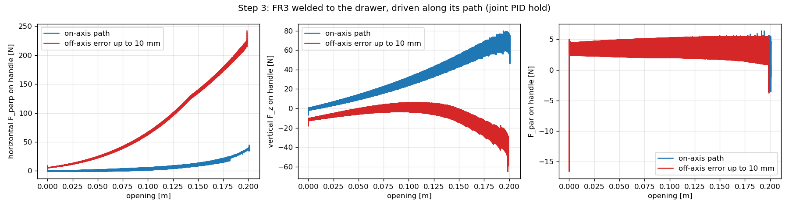


**What this shows:**
- **F is measured correctly in sign and size.** Through the hinge moment for the door, the weld carries a moment as well as a force; the published torque is about the hinge.
- **The closed kinematic chain behaves as the paper's Sec. 1 describes.** Motion along the path opens the mechanism with small forces.
- **The paper's central problem is reproduced.** A command just 10 mm off the path produces about 10× more off-axis force (over 100 N), enough to pull the handle out of a real gripper. This is what the assisted mode will remove.

**Finding 3: gravity drift of the joint hold (motivates τ_g in Eq. 7).**
- **Symptom:** in both runs the arm also pushes the handle *vertically*, up to about 76 N at the end of the drawer stroke. The force grows with the opening, in the middle plot.
- **Cause:** the temporary `arm_hold_controller` is a joint PID without gravity compensation. Its integral term holds the gravity load of the stretched arm, and lags as that load changes along the path.
- **Consequence:** the off-axis check therefore uses the horizontal component, which is the direction of the injected error. The step 4 Cartesian impedance controller with τ_g removes this drift.

**Finding 4: Gazebo's joint wrench convention.**
- **What Gazebo reports:** `JointWrench.body2Force` is the force the *child* applies *on the joint*, in the child link frame. The robot's force on the handle is therefore **F = −R_child · body2Force**.
- **How it was established:** with a 10 N push on drawers at two different yaws (`body2Force` ≈ (+9.7 … 10, …) along the drawer axis both times).

**Reachability of the FR3** (`reachability.py`). The table gives the opening that the selected start pose can follow continuously: out of a full 0.35 m drawer stroke, or 1.2 rad of door opening. "yaw ±0.4" tilts the axis away from pointing at the robot.

**drawer: followable opening [m] of 0.35 (handle at x, z; y = 0)**

| x [m] | z [m] | yaw -0.4 | yaw +0.0 | yaw +0.4 |
|---|---|---|---|---|
| 0.60 | 0.30 | 0.35 | 0.13 | 0.35 |
| 0.60 | 0.40 | 0.34 | 0.20 | 0.35 |
| 0.60 | 0.50 | 0.35 | 0.35 | 0.35 |
| 0.70 | 0.30 | 0.35 | 0.22 | 0.35 |
| 0.70 | 0.40 | 0.35 | 0.31 | 0.35 |
| 0.70 | 0.50 | 0.35 | 0.35 | 0.35 |
| 0.80 | 0.30 | 0.35 | 0.29 | 0.35 |
| 0.80 | 0.40 | 0.35 | 0.35 | 0.35 |
| 0.80 | 0.50 | 0.35 | 0.35 | 0.35 |

**door: followable opening [rad] of 1.20 (handle at x, z; y = 0)**

| x [m] | z [m] | yaw -0.4 | yaw +0.0 | yaw +0.4 |
|---|---|---|---|---|
| 0.60 | 0.30 | 1.00 | 0.75 | 0.35 |
| 0.60 | 0.40 | 0.95 | 0.75 | 0.35 |
| 0.60 | 0.50 | 0.95 | 1.20 | 0.65 |
| 0.70 | 0.30 | 0.95 | 1.20 | 0.40 |
| 0.70 | 0.40 | 0.95 | 1.20 | 0.65 |
| 0.70 | 0.50 | 0.90 | 1.20 | 0.85 |
| 0.80 | 0.30 | 0.90 | 0.85 | 0.70 |
| 0.80 | 0.40 | 0.90 | 0.85 | 0.95 |
| 0.80 | 0.50 | 0.85 | 1.20 | 1.20 |

A drawer pulled straight towards the robot is limited by the elbow and wrist
limits near the base (0.31 m at the default pose), while tilted axes reach the
full stroke. The default handle position was moved from x = 0.6 to **0.7 m**,
so a straight drawer covers the 0.25 m trial target and the door opens more
than 1 rad. Randomised trials should keep the handle pose within the cells
that reach the trial target; `sim.launch.py` prints a warning when the
requested stroke cannot be followed.

### 7.4 Phase 3 pilot experiments

**Task:** open the drawer 0.25 m. **Failure:** true |F⊥| (50 ms filter) above 30 N (handle loss), or 15 s timeout. The 30 N limit is a design assumption, not a measurement on the real gripper. **Baseline:** direct teleoperation, scripted operator at 0.1 m/s with a fixed heading error, ideal gravity compensation. **Design:** 10 heading errors × 3 axis tilts, with 6 conditions repeated four times: 48 trials, each from a full reset (mean reset 10.9 s).

| Heading error | Success | Opening reached (straight axis) |
|---|---|---|
| 0° | 6/6 | 0.251 m |
| 0.25° | 3/3 | 0.252 m |
| 0.5° | 2/6 (both tilted axes; straight axis 0/4) | 0.225 ± 0.008 m |
| 0.75° | 0/6 | 0.203 ± 0.004 m |
| 1° | 0/3 | 0.170 m |
| 2° | 0/6 | 0.110 m |
| 3° | 0/6 | 0.082 m |
| 5° | 0/6 | 0.055 m |
| 10° | 0/3 | 0.031 m |
| 20° | 0/3 | 0.016 m |

The task is feasible but has almost no margin: the handle is lost after 2.7–5.7 mm of sideways error, because the joint-controlled arm is stiff.

| Success | Failure (2° heading error) |
|---|---|
| 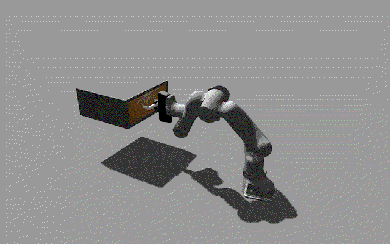 |  |

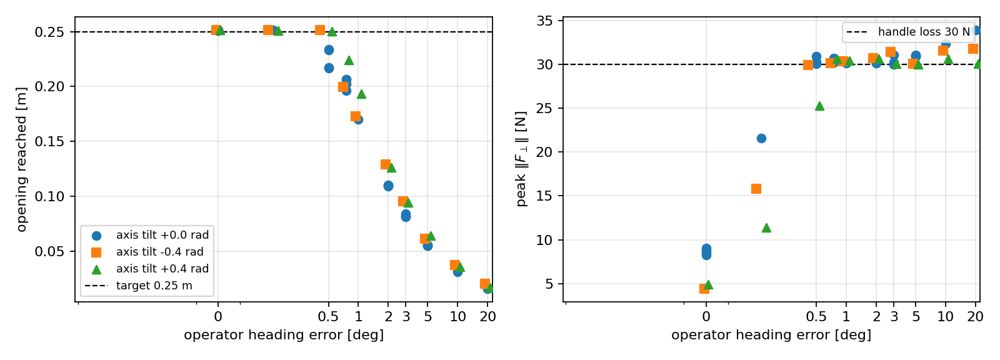

**Open points:**
- The weld force read 9–19% high against a known 10 N push; the cause is not known.
- An abrupt force jump near 0.20 m of opening in the 0.5° straight trials. **Likely explained in step 4:** with the drawer at x = 0.7 m, the last centimetres of the stroke fold the elbow (joint 4) to within 0.13 rad of its limit, where the arm is close to singular. The impedance controller shows the same jump there, and it disappears with the drawer at x = 0.8 m.
- No human operator has run the task.

The first pilot run was discarded: commands were lost until ROS 2 discovery finished, causing false early failures. `baseline_direct.py` now waits for the link, and all 48 trials were rerun.

### 7.5 Step 7: direct vs assisted with the impedance controller

**Setup:**
- **Controller:** step 4 impedance controller (600 N/m), with ideal gravity compensation.
- **Operator:** scripted, pushing at 0.1 m/s along the true initial direction turned by a fixed heading error. It never corrects, and it stops at 0.25 m of opening (arc length for the door).
- **Failure:** filtered true |F⊥| above 30 N, or a 15 s timeout.
- **Scenes:** drawer at x = 0.8 m with three axis directions; door with r = 0.6 m.
- **Conditions:** direct (v_c = u), assisted (fixture plus leak 2/s), and assisted without the leak (the paper baseline).
- **Trials:** 46 in total, each from a fresh simulation, with `run_experiments.sh`.

| Heading error | Drawer (straight), direct: success, peak F⊥ | Drawer (straight), assisted: success, peak F⊥ |
|---|---|---|
| 0° | 2/2, 4.5 N | 2/2, 3.5 N |
| 5° | 2/2, 11.9 N | 2/2, 2.1 N |
| 10° | 2/2, 26.1 N | 2/2, 5.1 N |
| 15° | 0/2 (lost at 0.18 m) | 2/2, 8.3 N |
| 20° | 0/2 (lost at 0.13 m) | 2/2, 11.4 N |
| 30° | 0/2 (lost at 0.08 m) | 2/2, 17.5 N |

| Scene | Direct | Assisted | Assisted, no leak |
|---|---|---|---|
| Drawer turned ±0.4 rad, 0° / 10° / 20° | 4/6 succeed; both 20° lost at 0.12 m | 6/6, peak ≤ 12.5 N | not run |
| Door, 0° / 10° / 20° | 0/3; lost at 0.21 / 0.13 / 0.09 m | 3/3, peak 9.9 / 10.0 / 13.5 N | 1/2 (10°: 25 N; 20°: lost at 0.22 m) |
| **All trials** | **10/21** | **21/21** | 3/4 |

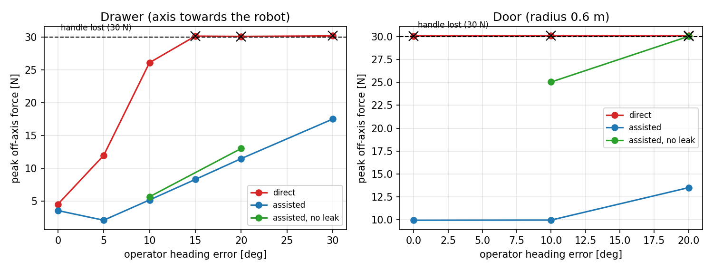

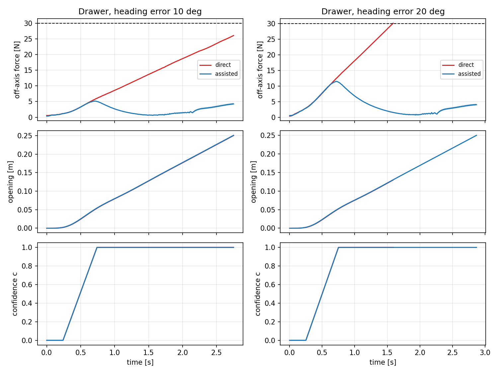

**What the plots show:**
- In the first 0.7 s both modes are identical: the estimator is still gathering samples, so the confidence c is below c₀ = 0.6 and the operator has full authority.
- Once c reaches 1, the assisted force falls back to a few newtons: the fixture removes the sideways command, and the leak removes the sideways stretch already built up.
- In direct mode the force keeps rising in proportion to the sideways drift, about K × s × tan θ.

**Findings:**
1. **Compliance alone widens the margin.** With the stiff joint PID (Phase 3), the handle was lost from 0.75°. With the 600 N/m impedance controller and direct control, it is lost from 15°.
2. **The helper closes the gap.**
   - Assisted control succeeded in all 21 trials up to 30°, on every drawer direction and on the door.
   - Its peak force stays well below the 30 N limit: 17.5 N at most on the drawer, 13.5 N on the door.
   - At 5–30° the drawer's peak force is 3–6 times lower than with direct control. At 0° the two modes are about equal.
3. **The door needs the helper even with a perfect aim.** The scripted operator keeps pushing in the door's initial direction, which turns away from the door's path as it swings. Direct control lost the door at 0°, while assisted control followed the turning tangent.
4. **The leak matters for the door.**
   - Without it, the assisted door reached 25 N at 10° and lost the handle at 20°.
   - The estimator lags the door's turning tangent (paper Eq. 5), and the stretch this lag builds up never decays without the leak.
5. **The start-up peak is the remaining weakness.** The highest forces in assisted mode (up to 17.5 N at 30°) come from the first 0.7 s, before the estimator is confident.

**Interactive check:** with `teleop.launch.py` and `fake_joy.py --lx 1 --ly 0.5` (a 27° push, like the keyboard sequence `a a a a w w`):
- **Assisted:** about 3 N off-axis once c = 1.
- **Direct:** 66 N off-axis.

**Limits:**
- The operator is scripted and never corrects, so no human has used the system yet.
- Some conditions have only one or two repetitions.
- The door direct trial at 0° succeeded (peak 24.9 N) in an earlier test run, so it is close to the limit.

### 7.6 Friction study and recorded sessions

**Setup:** the same scripted operator, on the straight drawer.
- **Joint friction:** 1, 3, 10, 20 and 30 N. The friction is set with `teleop.launch.py friction:=`.
- **Heading error:** 0°, 10° and 20°.
- **Control:** direct and assisted.
- **Trials:** 30, each recorded by `session_recorder` (video, data, summary). Run with `run_friction_study.sh`; analysed with `analyze_friction.py` and `analyze_sessions.py --root results/friction/videos`.

| Friction | Direct 10° | Assisted 10° | Direct 20° | Assisted 20° | Mean pulling force |
|---|---|---|---|---|---|
| 1 N | ✓ 25.8 N | ✓ 4.8 N | lost at 0.133 m | ✓ 10.6 N | 1.5 N |
| 3 N | ✓ 26.0 N | ✓ 5.2 N | lost at 0.130 m | ✓ 11.2 N | 3.5 N |
| 10 N | ✓ 27.3 N | ✓ 6.5 N | lost at 0.118 m | ✓ 13.8 N | 10.0 N |
| 20 N | ✓ 29.0 N | ✓ 8.1 N | lost at 0.101 m | ✓ 17.3 N | 19 N |
| 30 N | lost at 0.244 m | ✓ 9.9 N | lost at 0.085 m | ✓ 21.0 N | 27 N |

✓ = opened to 0.25 m, with the peak off-axis force. At 0° every trial succeeded, with a peak of at most 4.8 N. **Totals:** assisted 15/15, direct 9/15.

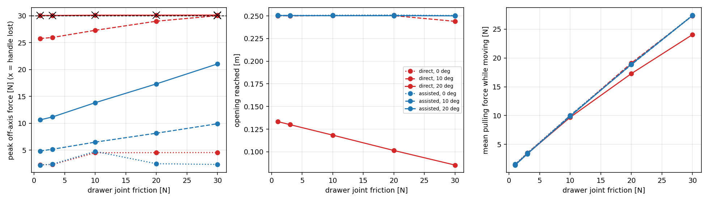

**Findings:**
1. **Friction raises the off-axis force in both modes.** The drawer only starts to move once the spring force exceeds the friction, which takes up to 5 cm of stretch at 30 N. Until it moves, the whole command builds up as error, including its sideways part. In assisted mode the estimator also needs motion before it gains confidence, so the start-up peak grows with friction (10.6 → 21.0 N at 20°).
2. **The haptic trigger saturates.** With ρ scaled from 2 to 15 N of pulling force (paper Eq. 8), R2 reads 0 below about 2 N of friction and 1 from 20 N. The scale needs to be tuned from human trials, as the paper itself proposes.
3. **The videos agree with the logs.** Checked frame by frame: the handle-lost banner appears at the logged opening, and assisted runs end at 0.25 m with about 3 N off-axis.

Video (local only, not in the repository): `results/friction/friction_h20_comparison.mp4`. Direct on the left, assisted on the right; 1 N on top, 30 N below; heading error 20°.

**Recorded sessions (human driving).** Session folders (videos, data, summaries), per-trial data and all videos and GIFs stay on the local machine and are not in the repository; only the summary tables and figures are. With `input:=dualsense` or `keyboard`, `teleop.launch.py` starts `session_recorder` by default. It writes `results/sessions/<UTC time>_<mode>_<kind>_f<friction>/` with `video.mp4` (camera view and live overlay), `data.csv` (`/sc/status` at 100 Hz) and `summary.json`. `scripts/drive.sh` starts, stops and saves sessions from the host, and `analyze_sessions.py` compares them. The DualSense was connected on 2026-11-25, and its rumble and trigger were confirmed by the operator.

**First human session** (2026-11-25, assisted, friction 3 N, 195 s; [sessions.md](results/sessions/sessions.md)):
- **Session:** 20 strokes (7 full open–close cycles), split by `analyze_sessions.py`.
- **Steering accuracy:** the operator's stick direction was a median **20°** off the drawer's axis (90th percentile 64°). In the scripted trials, direct control lost the handle from 15°. The fixture removed the off-axis part: the commanded sideways speed fell from about 0.02 to 0.001 m/s.
- **Off-axis force:** 2.1 N mean while moving. During normal travel the stroke peaks were 2–12 N. The session's single highest value, 19.0 N, came at the instant the drawer hit its end stop at 0.35 m. The force never came close to 30 N.
- **Haptics:**
  - Rumble was 0.35–0.5 on most opening strokes, mostly from the rejected-command term (paper Eq. 8): it told the operator they were steering off-axis.
  - R2 resistance was about 0.1 while the drawer slid (3.5 N pull) and jumped to 1 whenever the operator kept pushing against an end stop (pulling force up to 37 N).

**Four human sessions: direct vs assisted at 3 N and 20 N** (2026-11-25, one operator, DualSense).
- Made with `make_session_figures.py`, into [results/sessions/figures/](results/sessions/figures/).
- Every number below comes from `summary.json` and `data.csv`.
- The videos were checked against the logs: the handle-lost banner and the plotted 30 N crossing coincide.

| Session | Duration | Mean off-axis while moving | Peak off-axis | Time above 30 N | Mean rumble while moving |
|---|---|---|---|---|---|
| assisted, 3 N | 195 s, 7 open–close cycles | **2.1 N** | 19.0 N (end-stop impact) | 0 s | 0.24 |
| direct, 3 N | 80 s, 1 opening, then pushing at the stop | **11.1 N** | 22.4 N | 0 s | 0.51 |
| assisted, 20 N | 85 s, 3 cycles | **2.1 N** | 11.6 N | 0 s | 0.23 |
| direct, 20 N | 26 s, 1 opening | **27.1 N** | **47.8 N** | **20.9 s** (handle lost) | 0.87 |

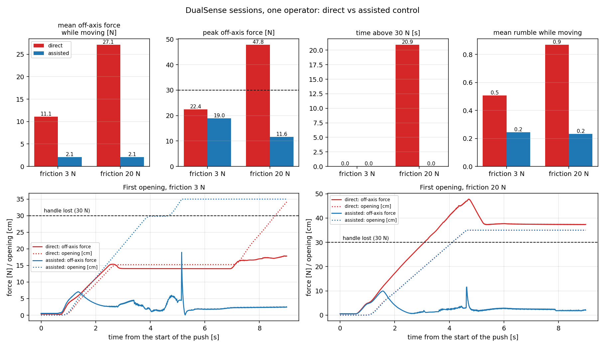

Videos and GIFs of each session's first opening (camera next to a live off-axis force plot; direct on top, assisted below) are made locally by `make_session_figures.py` in `results/sessions/figures/first_opening_f3.{mp4,gif}` and `first_opening_f20.{mp4,gif}`. They are not in the repository.

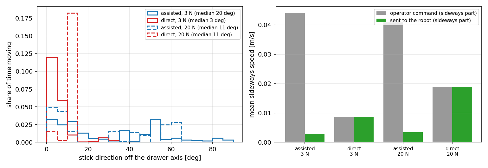

**What the sessions show:**
1. **The helper cut the off-axis force by 5 to 13 times.** The mean while moving was 2.1 N assisted against 11.1 N (3 N friction) and 27.1 N (20 N friction) direct.
2. **Only direct control at 20 N lost the handle.** The off-axis force passed 30 N after about 3 s of pulling (21 cm opening) and stayed above it for 21 s, with the rumble at full. Assisted control at 20 N never exceeded 11.6 N.
3. **The fixture removed most of the operator's sideways command.** The mean sideways speed fell from 0.044 to 0.003 m/s (3 N) and from 0.041 to 0.003 m/s (20 N). In direct mode the robot received the command unchanged (right panel).
4. **Confound: the operator steered differently in each mode.**
   - Direct 3 N: median 3° off the axis, carefully, and the first push stopped at 15 cm when the force and rumble rose.
   - Assisted: median 20° (3 N) and 11° (20 N), with many pushes at 40–60°.
   - So the helper allowed loose steering, and the rumble seems to have made the operator careful without it. The force ratio mixes both effects. A fair comparison needs a fixed instruction (for example "open as fast as you can") and several operators.
5. **Limits:** one operator, one session per condition, no fixed order or instruction. These are pilot data, not a user study.

**Bug found and fixed (anti-windup).**
- **Symptom:** in the direct 20 N session, a short push toward "close" did not move the drawer. After R2 was released, the arm kept pressing into the stop with about 58 N.
- **Cause:** while the operator pushes against an end stop, the set-point x_d keeps integrating past the stop, so a reversed command first has to unwind it.
- **Fix:** `shared_control` now keeps x_d within `max_lead` = 0.10 m of the gripper, the controller's own error cap, so the force is unchanged.
- **Check:** 7 s of pushing into the stop, then a 1 s reverse: the drawer moved back 5 cm, and the force along the drawer fell from 62 N to 0.
- **What it does not change:** pressing against the stop still reaches about 60 N while the operator keeps pushing (next steps, item 2).
- **Scope:** the scripted trials in §7.5–7.6 stop before any end stop and are not affected.

---

## 8. Changes with respect to the paper

| Paper | Project | Why |
|---|---|---|
| Franka Panda | **FR3** (`franka_description` 2.9.0) | the lab's robot |
| robosuite / MuJoCo | **ROS 2 Humble + Gazebo Classic 11 in Docker** | a path to the real robot through `ros2_control` / `franka_ros2` |
| x_d ← x_d + Δt·v_cmd | off-axis leak `perp_leak` | removes the start-up residual (Finding 1); 2/s in assisted runs from step 5, 0 in `sc_core.Params` and for direct runs |
| τ = JᵀΛ[K_p e − K_d ẋ] + τ_g + τ_null | τ = Jᵀ[K e − D ẋ] + N(…) (+ τ_g) with error cap, torque-rate limit and joint-limit repulsion | simpler, with a direct Lyapunov proof; Λ needs the exact inertia (§5.4) |
| drawer in front of the robot | drawer at x = 0.8 m from step 4 on (door 0.7 m) | at 0.7 m the stroke ends near the elbow limit (§7.4) |
| wrist F/T sensor | wrench of the gripper–handle weld (`/sc_weld/handle_wrench`) | it is exactly the force on the handle and needs no gravity compensation; on hardware use Franka's `O_F_ext_hat_K` |
| "welded grasp" in MuJoCo | Gazebo world plugin creating a fixed joint at run time | the mechanism must first be reached and the arm settled; handle loss is registered from F⊥ (optional `break_force`) |
| Panda start pose (unspecified) | IK start pose ranked by followable stroke | the FR3's joint limits restrict which mechanism poses can be opened (§7.3) |
| OSC from the start | joint PID hold during start-up, impedance controller after the weld | the arm must hold still while the weld closes |

---

## 9. Known issues and fixes

| Symptom | Cause | Fix |
|---|---|---|
| `parser error Couldn't parse parameter override rule` from `gazebo_ros2_control` | the plugin passes `robot_description` as a `--param` rule; single quotes in `franka_description`'s XML comments break it | `gazebo.launch.py` strips XML comments before publishing. Keep this in every Gazebo launch; do not edit `franka_description` |
| Every `ros2 …` call fails with `!rclpy.ok()` | stale ROS 2 CLI daemon | `ros2 daemon stop` (the scripts do it) |
| The wrong mechanism appears (e.g. a door when you asked for a drawer) | processes from a previous launch still publish the old `robot_description` | `bash scripts/stop_sim.sh` before every launch |
| `spawn_entity` times out on the very first start | Gazebo initialises `~/.gazebo` | launch again |
| The arm sags right after spawning | controllers start a few seconds after physics | expected: `go_to_start.py` brings it back |
| Impedance controller: the drawer stops near 0.20 m with up to several hundred newtons off-axis | drawer at x = 0.7 m: joint 4 reaches its limit near the end of the stroke | drawer at x = 0.8 m (default of `teleop.launch.py`); joint-limit repulsion in the controller |
| Impedance controller: direct trials never lose the handle | the error cap (0.05 m × 600 N/m = 30 N) equalled the handle-loss limit | cap raised to 0.10 m (60 N) in simulation |
| `stop_sim.sh` kills the command that called it | it kills every process whose command line contains `ros2 launch` | start launches with `docker exec -d` in a separate process (`run_sim_bg.sh`, `run_teleop_trial.sh`) |
| Controllers fail to activate with `paused:=true` | `ros2_control` only updates while physics steps | intended: paused mode skips the spawners and is only for inspecting the start pose |
| `/apply_joint_effort` "succeeds" but nothing moves | `start_time = 0` means simulation time 0, so a timed effort lies in the past | use `duration: {sec: -1}` (until removed) |
| Efforts keep acting after `/clear_joint_efforts` | efforts on a joint add up, and in our tests clearing did not remove them | remove an effort by applying its negative (as `record_gif.py` does) |
| The Gazebo GUI ignores the camera pose from the world file | Gazebo Classic GUI behaviour | use the scene camera (`/scene_camera/image_raw`) for images |
| `sim_startup`: `arm did not settle at the start pose` | the stretched arm needs more gravity torque than the hold PID's integral clamp allowed | the clamps were raised (`ros2_controllers.yaml`); if it persists, the mechanism pose is near the workspace border (§7.3) |
| A trial fails early with the opening still at 0 | commands were sent before ROS 2 discovery connected the new publisher to the controller | fixed: `baseline_direct.py` holds for 2 s of simulation time after the link is up |
| The weld service `/sc_weld/attach` is not found | `~/attach` is relative to the plugin node: a namespace `/sc_weld` plus the node name `sc_weld` gave `/sc_weld/sc_weld/attach` | `sc_weld.world` uses `<namespace>/</namespace>` |
| A weld on `fr3_hand` or `fr3_link8` fails (link not found) | Gazebo lumps links connected by fixed joints into their parent | weld `fr3_link7`, which carries the hand and the TCP |
| No messages from `/sc_weld/handle_wrench` (incompatible QoS) | it is published best effort (sensor data) | subscribe with `qos_profile_sensor_data` |
| `docker` reports permission denied right after setup | the group change needs a new login | log out and back in (or use `sg docker -c "…"`) |
| Very slow image build | slow network (about 0.15 MB/s here); the base image is about 1.2 GB | a better network; rebuilds reuse the cached layers |

---

## 10. Real hardware notes (step 8)

- **Robot variant:** `franka_description` distinguishes `fr3`, `fr3v2` and `fr3v2_1`. Joint limits differ only in rounding, so the simulation is unaffected, but the hardware launch must use the right one. ⏳ Ask the lab.
- **Real-time kernel:** `libfranka` needs PREEMPT_RT on the PC connected to the robot. That is a host setting that Docker cannot provide; laptop simulation does not need it.
- **Version matching:** `libfranka` / `franka_ros2` must match the FR3 system image. The Docker image will pin those versions in step 8.
- **Force signal:** on hardware, F comes from `O_F_ext_hat_K` (or an external F/T sensor). The `sc_core` convention is the force applied by the robot to the handle.
- **Container settings:** the container already uses host networking, all devices, `rtprio 99` and unlimited `memlock`, as FCI requires.

**What is ready (untested on a robot):** `sc_teleop/launch/hardware.launch.py` loads the same `CartesianImpedanceController` into `franka_ros2`'s controller manager with [fr3_hardware.yaml](ros2_ws/src/sc_teleop/config/fr3_hardware.yaml), starts `franka_wrench_relay` (O_F_ext_hat_K → `/sc/external_wrench`), `shared_control` without ground truth, `joy_node` and the haptics. Step-by-step instructions are in [README_SHARED_CONTROL.md](README_SHARED_CONTROL.md#real-fr3-step-8-not-tested-on-hardware).

**Hardware differences:**
- gains 400 N/m and 20 Nm/rad, error cap 5 cm, top speed 0.05 m/s;
- no τ_g, because libfranka compensates gravity;
- F = −O_F_ext_hat_K;
- opening is measured as the distance the gripper travels.

**Before the first run, check:**
- the `franka_msgs` field name for the external wrench in the installed `franka_ros2` version;
- that the spawner's `--param-file` option exists in that version;
- the torque-rate limit against the FCI rejection behaviour.

---

## 11. Changelog

- **2026-11-25: Four human DualSense sessions** (direct and assisted, 3 N and 20 N) analysed:
  - mean off-axis force 2.1 N assisted against 11.1 and 27.1 N direct; only direct at 20 N lost the handle;
  - new `make_session_figures.py`: comparison figures, synchronised camera-and-plot videos and GIFs;
  - fixed set-point wind-up at end stops (`max_lead`).
- **2026-11-25: First recorded human session** (assisted, 3 N) analysed; `analyze_sessions.py` splits sessions into strokes.
- **2026-11-25: Recording, friction study, objectives check.**
  - New `session_recorder`: video with a live overlay, a data log and a summary for every keyboard or DualSense run.
  - New scripts: `drive.sh` (one-command recorded sessions), `analyze_sessions.py`, `make_grid_video.py`.
  - `teleop.launch.py` gains `friction`, `damping`, `record`, `video` and `sessions_dir`; `shared_control` publishes `/sc/status`.
  - Friction study (30 recorded trials, §7.6): assisted 15/15, direct 9/15. The haptic trigger scale saturates above about 20 N.
  - Added the objectives check and next steps (§12).

- **2026-11-25: DualSense connected.**
  - `joy_node` now runs with `SDL_JOYSTICK_HIDAPI=0` (kernel `hid-playstation` driver). This gives the expected axis order and leaves the HID channel to `pydualsense`.
  - `/joy` input reaches `shared_control` at about 36 Hz.
  - The rumble and trigger commands are sent without errors.

- **2026-11-24: Steps 4 to 8.**
  - **Step 4:** new package `sc_control`, a C++ `ros2_control` Cartesian impedance controller (KDL; null-space posture, joint-limit repulsion, optional gravity term, error cap, torque-rate and torque limits; Lyapunov argument in §5.4). `sim.launch.py controller:=impedance` switches from the joint hold to it after the weld.
  - **Step 5:** new package `sc_teleop`:
    - `shared_control` runs the paper's loop on the controller, with the scripted or joystick operator, haptics, metrics and logs, and a 0.5 s joystick timeout;
    - `dualsense_haptics` drives the rumble and the R2 adaptive trigger;
    - `keyboard_joy.py` now shows rumble and trigger bars.
  - **Step 6:** `teleop.launch.py` starts everything with one command (`mode`, `input`, `kind`, `heading`, ...); parameters are in `config/shared_control.yaml`.
  - **Step 7:** 46 trials (`run_experiments.sh`, `analyze_step7.py`, `results/step7/`). Assisted: 21/21 succeeded; direct: 10/21 (§7.5).
  - **Step 8:** hardware launch, FR3 gains and the Franka wrench relay. **Not tested on a robot.**
  - **Drawer position:** the drawer moved to x = 0.8 m for steps 4 onwards. At 0.7 m the elbow folds to its limit near the end of the stroke, which most likely also explains the jump near 0.20 m in Phase 3.
  - **Docs:** new easy guide [README_SHARED_CONTROL.md](README_SHARED_CONTROL.md).
  - **Tests:** start-pose tests now include the drawer at x = 0.8 m (8 tests); `sc_teleop` has 4 tests.

- **2026-11-01: Phase 3 complete.**
  - Added the direct teleoperation baseline (`baseline_direct.py`), the `ideal_gravity_comp` option and the success and failure criteria.
  - Ran 48 pilot trials (`run_pilot.sh`, `analyze_pilot.py`, `results/phase3/`).
  - Wrote the Phase 3 report (`docs/phase3_report/`), edited with the avoid-ai-writing rules.
  - Gazebo replaces PyBullet for the course phases (agreed).
  - Report rewritten as an anonymous third-person research report.
  - Report rewritten again for readability: new "The controller" section (operator command, target point, damped-least-squares IK, joint PID with gains, gravity compensation, effective stiffness) with a control-loop diagram, a "Sensing" section including the joint-torque force estimate, and a corrected note on the force reading (the extra force is most likely real).
  - Added `README_PHASE3.md` (installation, launch, controls, reset), with its commands tested.
  - Added `scripts/keyboard_joy.py`: drive the robot from the keyboard, publishing `/joy` like a DualSense.
  - Removed the `host$` / `container$` prefixes from commands, which broke copy-paste; a comment line now marks where to run each block.
  - Fixed the `--joy` mode: stick signs, an untouched R2 no longer counts as half throttle, and trials now end by the same criteria. Added `scripts/fake_joy.py`.
  - Added a 57 s summary video: one recorded success and one failure with a live force gauge, the pilot plot and the main result.
  - Report made self-contained (figures, table) with Gazebo screenshots, scene variants, validation plots and trial outcomes.

- **2026-10-28: Step 3 done: welded grasp and handle wrench.**
  - `sc_core`: added `kinematics.py` (URDF chain, Jacobian, IK) and `grasp.py` (handle path and tangent, grasp pose, start-pose solver), with 9 new tests.
  - New package `sc_gazebo`: weld plugin publishing **F**, `sim.launch.py` with the IK start pose, the deterministic `sim_startup.py`, `weld_check.py`, `reachability.py`, and FR3 start-pose tests.
  - `sc_description`:
    - the default handle position moved to x = 0.7 m;
    - `gazebo.launch.py` gained the `world`, `initial_positions_file` and `controllers` arguments;
    - the hold PID integral was strengthened.
  - Findings 3 (gravity drift of the joint hold) and 4 (Gazebo wrench convention), plus the reachability table.
  - Scripts `run_sim_bg.sh` and `capture_step3.sh`.
  - Step 3 GIFs and force plots.
  - The course repository (kfupm-arm-lab, PyBullet) was reviewed. Its DualSense mapping (dead-zone 0.08; left stick x/−y, right stick −z) will be reused in step 5.

- **2026-10-28: README architecture section taken from the paper.**
  - Problem statement, Fig. 1 (block diagram), Table 2 (blocks, with their implementation status), Fig. 2 (assistance geometry) and Eqs. 3–8.
  - Repository prepared for GitHub, with `franka_description` as a submodule.

- **2026-10-28: Step 2 visual verification. README rewritten.**
  - Added a fixed scene camera (`/scene_camera/image_raw`, the operator view), a temporary `arm_hold_controller` (`joint_trajectory_controller` on the effort interfaces) and `go_to_start.py`, so the arm holds its start pose.
  - Added launch arguments `paused`, `damping`, `friction` and `mass`.
  - Added helper scripts: `stop_sim.sh`, `snapshot.py`, `record_gif.py`, `screenshot.sh`, `xwd2png.py`, `capture_scenes.sh`.
  - Fixed `smoke_gazebo.sh` so it no longer leaves processes behind.
  - Documented the ApplyJointEffort pitfalls.
  - Added images and GIFs of both scenes.
- **2026-10-28: Container built and step 2 verified headless.**
  - All tests pass in the container.
  - Fixed the `gazebo_ros2_control` URDF quoting error (comments are stripped in the launch file).
  - Added `smoke_gazebo.sh`.
- **2026-10-28: Step 2 written.**
  - The lab robot is the FR3; vendored `franka_description` 2.9.0.
  - Added the `sc_description` package.
- **2026-10-28: Switched to ROS 2 Humble in Docker** (from native Foxy, which is end-of-life). Added the Dockerfile, compose file and host setup script.
- **2026-10-28: Step 1 done.**
  - Added the `sc_core` library, the offline simulator and 14 tests.
  - Found the start-up residual issue and added the optional `perp_leak`.

---

## 12. Objectives check and next steps

Checked against the design document ([main.tex](LaTeX_Literature_Review/main.tex)), the course Phase 3 brief and the standing project instructions (2026-11-25).

| Objective | Source | Status |
|---|---|---|
| Online tangent estimator from the robot's own motion (Lutscher et al. 2010), with speed gate, sign alignment and confidence | paper Sec. 3.3, Eq. 4 | ✅ `sc_core.estimator`, running in Gazebo at 100 Hz |
| Confidence-weighted guidance virtual fixture | paper Eq. 6 | ✅ `sc_core.assistance`; plus the off-axis leak (§8) |
| Compliant low-level control | paper Eq. 7 | ✅ Cartesian impedance controller (`sc_control`); simplified to Jᵀ[K e − D ẋ], with a Lyapunov argument (§5.4) |
| Rumble for off-axis force and rejected command; R2 resistance for opening force | paper Eq. 8 | ✅ implemented and felt on a real DualSense; ⚠ the trigger scale saturates for stiff drawers (§7.6) |
| Haptic thresholds set from pilot trials | paper Sec. 3.5 | ⚠ still the defaults; needs human sessions |
| Direct and assisted modes with identical feedback | paper Sec. 3, Conclusion | ✅ same haptics and controller, only the fixture differs |
| Metrics: opening time, off-axis force, handle loss, opening distance | paper block 11 | ✅ in every trial and session, computed with the ground-truth tangent |
| Drawers and doors, with the axis unknown to the robot | paper Sec. 3.2 | ✅ drawer at three axis directions, door with r = 0.6 m; ⚠ directions were fixed, not randomised per trial, and only one door radius |
| User study measuring off-axis force under assistance | paper Sec. 2.6 (the gap it names) | 🟡 pilot: 4 sessions, one operator, direct vs assisted at 3 N and 20 N (§7.6); a real study needs several operators, a fixed instruction and repetitions |
| Real FR3 | course and project plan, step 8 | ❌ launch and configuration written, not run on a robot |
| Phase 3: executable scenario with a README (installation, launch, controls, reset), specification, baseline, pilot experiments | course brief | ✅ [README_PHASE3.md](README_PHASE3.md), report, 48 pilots (Gazebo instead of PyBullet, agreed) |
| README updated after every task; no AI attribution; no personal email | standing instructions | ✅ |

**Next steps, in order:**
1. **Proper human trials.** Use a fixed task and instruction ("open to 25 cm and close again, quickly, three times"), and alternate the mode order, at 3 N and 20 N. Use several operators if possible; each one runs `drive.sh`, then `analyze_sessions.py` and `make_session_figures.py`.
2. **End-stop force.** Anti-windup is done, but while the operator keeps pushing at a stop the arm still presses with up to 60 N (the error cap). On hardware, limit the along-axis error once the gripper stalls, for example to 2 cm (12 N).
3. **Tune the haptics from those sessions.** Set the R2 scale (F∥,0, F∥,1) from the pulling forces actually seen, or scale it to the force at the start of motion. Check that the rumble thresholds (F₀ = 2 N, F₁ = 20 N) separate good and bad steering.
4. **Reduce the start-up peak.** It is now the largest force in assisted mode (up to 21 N at 30 N friction). Options: seed d̂ with the operator's first command, a faster confidence ramp, or lower the stiffness until c > c₀.
5. **Broaden the scenes.** Randomise the yaw per trial (hidden from the operator), use more door radii, and put the door in the friction study.
6. **Final report.** Extend the Phase 3 report with §7.5–7.6 and the human sessions.
7. **Hardware (step 8).** Run on the lab FR3, slowly, with the user stop in hand: first hold still, then direct mode at 0.02 m/s, then assisted. Check the `franka_ros2` version items listed in §10.

