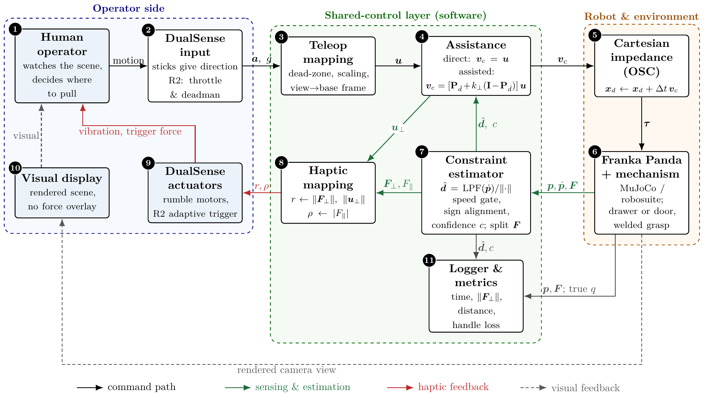
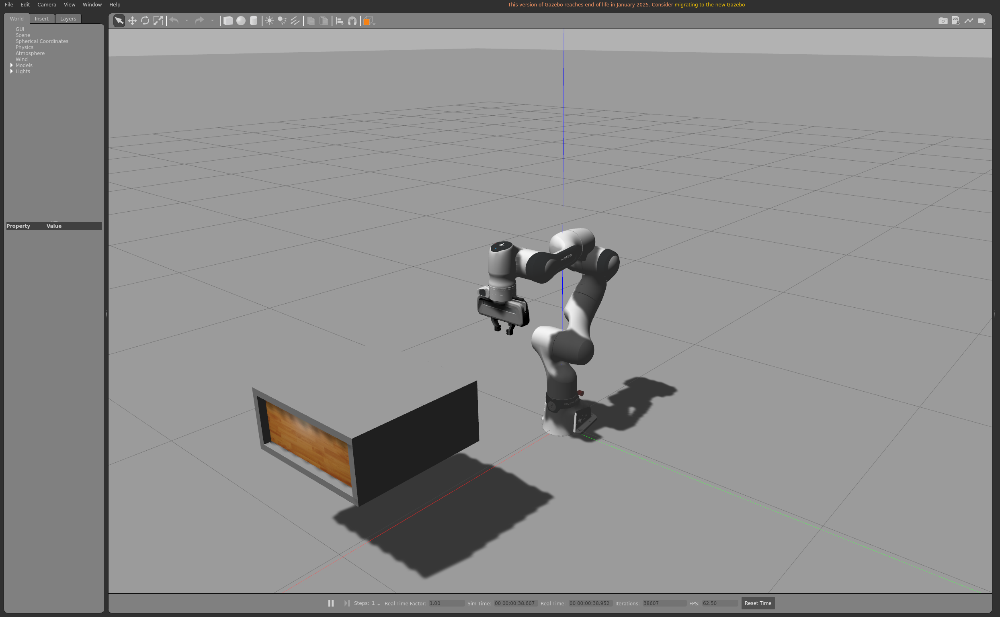
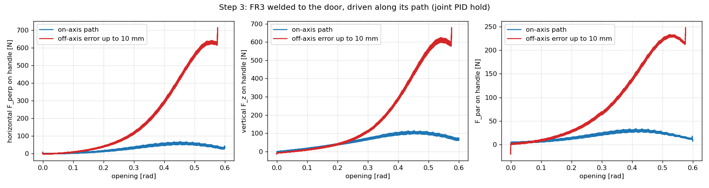

# SCE 571 – Shared-Control Teleoperation of Unknown Constrained Mechanisms

Course project for **Robot Dynamics and Control**. A **Franka Research 3 (FR3)**
holds the handle of a drawer or door whose axis is unknown, and an operator
drives it with a **Sony DualSense** controller. The robot estimates the
mechanism's permitted direction online (Lutscher et al., ICRA 2010). In
*assisted* mode it projects the operator's command onto that direction, as a
guidance virtual fixture. Rumble reports off-axis force, and the R2 adaptive
trigger reports opening resistance.

- **Design document (paper):** [LaTeX_Literature_Review/main.tex](LaTeX_Literature_Review/main.tex)
- **Stack:** ROS 2 Humble and Gazebo Classic 11 in **Docker**, on an Ubuntu 20.04 host with an RTX 4090. The same image is used later on the real FR3.

| Drawer, axis towards the robot | Drawer, axis tilted 0.4 rad | Door, r = 0.6 m |
|---|---|---|
|  |  |  |

*Step 3, 2026-10-28.*
- **Grasp:** the FR3 starts with its gripper on the handle (IK) and is welded to it.
- **Motion:** it opens the mechanism by following the true path with the temporary joint hold controller.
- **Measurement:** the weld measures the force on the handle, **F**.

The operator and the shared-control loop arrive in steps 4–5.

---

## Contents

1. [Run the simulation (step by step)](#1-run-the-simulation-step-by-step)
2. [Project plan and status](#2-project-plan-and-status)
3. [Architecture](#3-architecture)
4. [Repository layout](#4-repository-layout)
5. [Packages](#5-packages)
6. [Helper scripts](#6-helper-scripts)
7. [Results](#7-results)
8. [Changes with respect to the paper](#8-changes-with-respect-to-the-paper)
9. [Known issues and fixes](#9-known-issues-and-fixes)
10. [Real hardware notes (step 8)](#10-real-hardware-notes-step-8)
11. [Changelog](#11-changelog)

---

## 1. Run the simulation (step by step)

Commands prefixed with **host$** run in a normal terminal on the laptop.
Commands prefixed with **container$** run inside the Docker container. Never
source ROS 2 on the host, and never source ROS 1 Noetic in the container.

### 1.1 One-time setup (already done on this laptop)

```bash
host$ git clone --recurse-submodules https://github.com/nayon007/Shared-Control-Teleoperation.git ~/SCE_571_ws
host$ bash ~/SCE_571_ws/scripts/setup_host_docker.sh   # Docker, NVIDIA toolkit, DualSense udev rule (sudo)
# log out and back in (docker group), then check the GPU inside Docker:
host$ docker run --rm --gpus all ubuntu:22.04 nvidia-smi
host$ cd ~/SCE_571_ws && docker compose build          # builds sce571/humble-dev (~3.9 GB, slow on a slow network)
```

### 1.2 Every session

```bash
# 1. allow the container to open windows (once per login)
host$ xhost +local:docker

# 2. start the container (it keeps running in the background)
host$ cd ~/SCE_571_ws && docker compose up -d

# 3. open a shell inside it (repeat in more terminals if needed; ROS is pre-sourced)
host$ docker compose exec dev bash

# 4. build the workspace (first time, or after changing code)
container$ cd ~/SCE_571_ws/ros2_ws && colcon build --symlink-install && source install/setup.bash

# 5. launch the simulation: FR3 with its gripper welded to the handle (step 3)
container$ ros2 launch sc_gazebo sim.launch.py                       # drawer, axis towards the robot
container$ ros2 launch sc_gazebo sim.launch.py yaw:=2.74             # drawer with a tilted axis
container$ ros2 launch sc_gazebo sim.launch.py kind:=door radius:=0.6  # door
```

The terminal prints the computed start pose. After about 20 s it shows
`[sim_startup]: welded fr3_link7 to mech_moving` and then `simulation ready`.
The start-up sequence (§5.3) keeps the arm from sagging, and the gripper is
attached to the handle.

To try the system, run in a second terminal:

```bash
container$ ros2 run sc_gazebo weld_check.py --demo      # the arm opens and closes the mechanism
container$ ros2 run sc_gazebo weld_check.py             # full step 3 validation (§7.3)
```

**Launch arguments of `sim.launch.py`:**

| Argument | Default | Meaning |
|---|---|---|
| `kind` | `drawer` | `drawer` or `door` |
| `x y z yaw` | `0.7 0 0.4 3.14159` | pose of the handle at q = 0; +x of this frame is the opening direction, so `yaw` randomises the axis (π = towards the robot). See §7.3 for the reachable range |
| `radius` | `0.6` | door: hinge to handle [m] |
| `damping` | `5.0` | joint damping [Ns/m or Nms/rad] |
| `friction` | `3.0` | joint Coulomb friction [N or Nm] |
| `mass` | `2.0` | drawer / door leaf mass [kg] |
| `stroke` | 0.28 m / 0.75 rad | opening the start pose must be able to follow (trial target 0.25 m of handle travel, plus margin) |
| `weld` | `true` | attach the gripper to the handle after start-up |
| `robot_type` | `fr3` | `fr3`, `fr3v2` or `fr3v2_1` (must match the lab robot for hardware) |
| `gui` | `true` | `false` for headless runs |

`ros2 launch sc_description gazebo.launch.py` (step 2) still starts the scene
without the weld, with the arm in the Franka "ready" pose. It also accepts
`paused:=true` for inspecting models.

### 1.3 Useful checks (second container terminal)

```bash
container$ ros2 control list_controllers              # joint_state_broadcaster, gripper_controller, arm_hold_controller
container$ ros2 topic echo /sc_weld/handle_wrench      # F (and torque) of the robot on the handle, world frame, 500 Hz
container$ ros2 topic echo /sc_weld/attached           # true while welded
container$ ros2 service call /sc_weld/detach std_srvs/srv/Trigger   # let go of the handle (attach: /sc_weld/attach)
container$ ros2 topic echo /mechanism/joint_states    # ground-truth q of the drawer/door (logger only!)
container$ ros2 topic echo /joint_states              # FR3 joints
container$ ros2 run rqt_image_view rqt_image_view /scene_camera/image_raw   # operator view

# push the mechanism with 10 N, then remove the push again (efforts add up, see §9);
# while welded, /sc_weld/handle_wrench shows the arm resisting the push
container$ ros2 service call /apply_joint_effort gazebo_msgs/srv/ApplyJointEffort \
             "{joint_name: mechanism::mech_joint, effort: 10.0, duration: {sec: -1}}"
container$ ros2 service call /apply_joint_effort gazebo_msgs/srv/ApplyJointEffort \
             "{joint_name: mechanism::mech_joint, effort: -10.0, duration: {sec: -1}}"
```

**Models only, in RViz (no physics):** drag the sliders to move the arm and the drawer or door.

```bash
container$ ros2 launch sc_description view.launch.py              # or kind:=door
```

### 1.4 Stop

```bash
container$ bash ~/SCE_571_ws/scripts/stop_sim.sh    # or Ctrl-C in the launch terminal
host$ docker compose down                           # stop the container (files stay on the host)
```

Always stop the old simulation before you launch a new one. Leftover
processes publish a stale robot model that the next launch would spawn
(see §9).

### 1.5 Tests

```bash
container$ cd ~/SCE_571_ws/ros2_ws && colcon test --packages-select sc_core sc_description sc_gazebo && colcon test-result --verbose
container$ bash ~/SCE_571_ws/scripts/smoke_gazebo.sh [kind:=door]   # step 2 scene, headless check
host$      bash ~/SCE_571_ws/scripts/run_sim_bg.sh gui:=false       # step 3 sim headless, waits for /sim_ready
container$ ros2 run sc_gazebo weld_check.py --seconds 10            # then the step 3 validation
container$ ros2 run sc_gazebo reachability.py --markdown            # workspace table of §7.3 (~25 min)
host$      cd ~/SCE_571_ws/ros2_ws/src/sc_core && python3 -m unittest discover -s test   # core only, no ROS
```

### 1.6 Regenerate the images and GIFs in this README

```bash
host$ bash ~/SCE_571_ws/scripts/capture_step3.sh    # step 3 GIFs and images (container must be up)
host$ bash ~/SCE_571_ws/scripts/capture_scenes.sh   # step 2 images and GIFs
```

---

## 2. Project plan and status

| # | Step | Where | Status |
|---|------|-------|--------|
| 0a | Host setup: Docker Engine, NVIDIA Container Toolkit, DualSense udev rule | [scripts/setup_host_docker.sh](scripts/setup_host_docker.sh) | ✅ done (Docker 28.1, NVIDIA runtime) |
| 0b | Dev container: Humble, Gazebo 11, `ros2_control`, joy, pydualsense; GPU, X11, devices, host network | [docker/Dockerfile](docker/Dockerfile), [compose.yaml](compose.yaml) | ✅ done (`sce571/humble-dev`, RTX 4090 visible inside) |
| 1 | Core algorithms (estimator, fixture, haptics, mapping, metrics), offline closed-loop simulator, tests | [ros2_ws/src/sc_core](ros2_ws/src/sc_core) | ✅ done |
| 2 | FR3 + hand with `ros2_control` for Gazebo; drawer / door model; world; scene camera; launch files; temporary joint hold | [ros2_ws/src/sc_description](ros2_ws/src/sc_description) | ✅ done; 5 tests, headless smoke test, GUI images and GIFs above |
| 3 | Start pose with the gripper on the handle (IK in `sc_core`); weld plugin (fixed joint hand ↔ `mech_moving`) publishing the handle wrench **F**; deterministic start-up; validation, reachability study | [ros2_ws/src/sc_gazebo](ros2_ws/src/sc_gazebo) | ✅ done; all checks pass for drawer and door (§7.3) |
| 4 | Cartesian impedance controller (paper Eq. 7, with gravity compensation τ_g) as a C++ `ros2_control` controller on the effort interfaces (KDL in sim, Franka model on hardware); replaces `arm_hold_controller` | `sc_control` | ⬜ **next** |
| 5 | ROS 2 nodes: DualSense input, shared-control node (100 Hz, uses `sc_core`, F from `/sc_weld/handle_wrench`), haptics output (pydualsense), logger | `sc_teleop` | ⬜ |
| 6 | Launch files and parameter YAML for direct / assisted trials, rosbag recording | `sc_bringup` | ⬜ |
| 7 | Experiments: randomised trials, metrics, plots for the report | `sc_core.metrics` + scripts | ⬜ |
| 8 | Real hardware: same image on the robot PC (PREEMPT_RT host kernel), `franka_ros2` + `libfranka` matched to the FR3 system image, safety limits | `sc_bringup` (hw launch) | ⬜ |

**Open decisions:**
- **Keep `perp_leak` for the trials** (see §7.1)? Recommended: yes.
- **Which FR3 variant does the lab have**, and which system-image version?

---

## 3. Architecture

*Source: Sec. 3 of the paper ([main.pdf](LaTeX_Literature_Review/main.pdf)).*

### 3.1 Problem

Once the gripper holds the handle, the arm and the mechanism form a closed
kinematic chain. Only motion along the mechanism's path is admissible. Any
commanded motion in another direction turns into internal force at the handle,
large enough to damage hardware, pull the handle out of the gripper or trip the
robot's safety limits. An operator using a gamepad cannot feel these forces and
does not know in advance which way the mechanism moves.

The control problem is therefore *compliant manipulation under an unknown
kinematic constraint, avoiding forces perpendicular to the permitted motion*.

The approach combines two ideas:
- **The online tangent estimator of Lutscher et al. (2010)**, which reads the permitted direction from the robot's own compliant motion.
- **A guidance virtual fixture (Marayong et al. 2003)**, which filters the operator's command by projecting it onto that direction.

The study compares **direct** control (the command passes unchanged) with
**assisted** control (the command is projected onto the estimated tangent).
Both modes give identical haptic feedback, so differences in opening time,
off-axis force, handle loss and opening distance can be attributed to the
assistance itself.

### 3.2 Block diagram



*Fig. 1 of the paper.*
- **Direct control:** block 4 passes the operator command through unchanged.
- **Assisted control:** block 4 projects the command onto the estimated tangent d̂ supplied by block 7.
- **Feedback channels:** the operator receives the rendered scene (dashed grey) and the DualSense haptics (red).
- **Ground truth:** the true joint coordinate q reaches only the logger, never the controller or the estimator.

*Note:* the paper's block 6 reads "Franka Panda + MuJoCo / robosuite". In this
project it is the **FR3 in Gazebo Classic**, and later the real FR3 (see §8).

| # | Block | Function | Outputs | Implemented in |
|---|---|---|---|---|
| 1 | Human operator | Chooses the target, judges progress from the rendered scene, reacts to haptic cues | thumb and finger motion | — |
| 2 | DualSense input | Left stick: planar direction. Right stick: vertical. R2 depression g ∈ [0,1]: speed scale and deadman | stick axes **a**, throttle g | `joy` (step 5) |
| 3 | Teleop mapping | Dead-zone, speed limit v_max, rotation from the viewing frame to the base frame | **u** = g·v_max·**R**·φ(**a**) | `sc_core.teleop_mapping` ✅ |
| 4 | Assistance | Passes **u** unchanged (direct) or applies the confidence-weighted guidance fixture (assisted) | **v**_c | `sc_core.assistance` ✅ |
| 5 | Cartesian impedance / OSC | Integrates **v**_c into a desired pose and tracks it compliantly, so the mechanism can deflect the end-effector | joint torques **τ** | `sc_control` (step 4) |
| 6 | Robot + mechanism | Arm, welded grasp, prismatic drawer or revolute door with friction and damping; axis randomised per trial | **p**, **ṗ**, **F**; ground truth q | `sc_description` ✅ + weld (step 3) |
| 7 | Constraint estimator | Filtered, gated and sign-aligned tangent estimate; splits the wrench into along-path and off-axis parts | d̂, c, F∥, **F**⊥ | `sc_core.estimator`, `sc_core.haptics` ✅ |
| 8 | Haptic mapping | Off-axis force and rejected command → rumble r; along-path force → trigger resistance ρ | r, ρ ∈ [0,1] | `sc_core.haptics` ✅ |
| 9 | DualSense actuators | Rumble motors and R2 adaptive trigger | vibration, trigger force | `pydualsense` (step 5) |
| 10 | Visual display | Rendered view of robot and mechanism, identical in both modes | visual feedback | scene camera `/scene_camera/image_raw` ✅ |
| 11 | Logger & metrics | Records all signals; computes opening time, off-axis force, handle-loss events, opening distance | time series, metrics | `sc_core.metrics` ✅ + logger (step 5) |

### 3.3 Control laws (paper Eqs. 3–8)


*Fig. 2 of the paper.*
- **(a) Drawer:** the operator command **u** is split into the part along the estimated axis, which is executed, and the rejected part **u**⊥, which is removed in assisted mode and reported by vibration.
- **(b) Door:** the true tangent **d**\* rotates as the door opens. The filtered estimate d̂ trails it by a small angle δ, so a small radial force **F**⊥ remains and is absorbed by the controller's compliance.

**Force split** (Eq. 3). F is the force applied by the robot to the handle:

```
F∥ = d̂ᵀ F        F⊥ = (I − d̂ d̂ᵀ) F        u⊥ = (I − d̂ d̂ᵀ) u
```

**Constraint estimator** (Eq. 4). This is the Lutscher et al. (2010) estimator
with three additions: a speed gate, sign alignment and a confidence measure.

```
v̄_k = (1−β) v̄_{k−1} + β ṗ_k
if ‖v̄_k‖ > v_min:   m_k = v̄_k/‖v̄_k‖,  flipped if m_kᵀ d̂_{k−1} < 0,  pushed into a window W of N samples
d̂_k = Σ_W m / ‖Σ_W m‖          c_k = ‖Σ_W m‖ / N  ∈ [0, 1]
```

**Door lag** (Eq. 5): δ ≈ ‖ṗ‖ T_f / ϱ. For example, 0.1 m/s, ϱ = 0.5 m and T_f = 0.2 s give δ ≈ 0.04 rad.

**Assistance: confidence-weighted guidance fixture** (Eq. 6):

```
v_c = [ P + k⊥(c) (I − P) ] u ,   P = d̂ d̂ᵀ ,   k⊥(c) = 1 − (1 − k_min) · sat_[0,1]( (c − c0) / (c1 − c0) )
```

While c ≤ c0, the operator keeps full authority (the start-up phase). As the
samples align, k⊥ falls to k_min (0.05), and the fixture becomes effectively hard.

**Low-level control: operational-space impedance** (Eq. 7):

```
x_d ← x_d + Δt v_c
τ = Jᵀ Λ [ K_p (x_d − x) − K_d ẋ ] + τ_g + τ_null
```

With the handle constrained, x_d − x can grow only in the blocked directions,
and the force on the mechanism is about K_p times that error. That is why the
lateral command must be removed at its source.

**Haptic feedback** (Eq. 8):

```
r = sat_[0,1]( (‖F⊥‖ − F0)/(F1 − F0) + κ_u ‖u⊥‖ / v_max )        ρ = sat_[0,1]( (|F∥| − F∥0)/(F∥1 − F∥0) )
```

All parameters, with their paper symbols and defaults, are in
[`sc_core/params.py`](ros2_ws/src/sc_core/sc_core/params.py). One cycle of the
loop (paper Algorithm 1) is implemented in
[`sc_core/offline_sim.py`](ros2_ws/src/sc_core/sc_core/offline_sim.py) and will
run in the step 5 shared-control node.

### 3.4 Software mapping

```
 DualSense ──joy──► teleop mapping ──u──► assistance ──v_c──► set-point ──x_d──► Cartesian impedance ──τ──► FR3 + drawer/door
   ▲   (block 2)        (3)              (4)  ▲              integration      controller (5)              (Gazebo / real)
   │                                          │ d̂, c                                                       (6)
   │                                    constraint estimator (7) ◄─────────── p, ṗ, F (handle) ────────────┘
   │                                          │ F⊥, F∥, u⊥
   └── rumble r, trigger ρ ◄── haptic mapping (8)                 logger & metrics (11) ◄── all signals + true q
   scene camera (10) ──► operator
```

Blocks 3, 4, 7, 8 and 11 live in the ROS-independent `sc_core` library, so the
same code runs in the offline simulator, in Gazebo and on the robot. Only
blocks 5 and 6 differ between simulation and hardware.

**Design rule:** the controller uses only the standard `ros2_control` interfaces,
and the teleop nodes use only standard messages (`geometry_msgs`,
`sensor_msgs/Joy`). Switching from Gazebo to the real FR3 is then a launch-file
change.

**Interfaces available so far:**

| Topic / service | Type | Source |
|---|---|---|
| `/joint_states` | `sensor_msgs/JointState` | joint_state_broadcaster (FR3 arm + fingers) |
| `/mechanism/joint_states` | `sensor_msgs/JointState` | Gazebo; ground truth q, **logger only** |
| `/robot_description`, `/mechanism/robot_description` | `std_msgs/String` | robot_state_publisher |
| `/scene_camera/image_raw` | `sensor_msgs/Image` 1280×800 @ 15 Hz | operator view (block 10) |
| `/arm_hold_controller/joint_trajectory` | `trajectory_msgs/JointTrajectory` | temporary joint hold (until step 4) |
| `/gripper_controller/commands` | `std_msgs/Float64MultiArray` | finger opening [m] |
| `/apply_joint_effort` | `gazebo_msgs/srv/ApplyJointEffort` | test pushes on `mechanism::mech_joint` |
| `/sc_weld/handle_wrench` | `geometry_msgs/WrenchStamped`, 500 Hz, best effort | **F**: force of the robot on the handle [N], world (= FR3 base) frame; torque [Nm] about the `mech_moving` origin (drawer: grasp point at q = 0; door: hinge) |
| `/sc_weld/attached` | `std_msgs/Bool`, transient local | weld state |
| `/sc_weld/attach`, `/sc_weld/detach` | `std_srvs/srv/Trigger` | close / open the weld |
| `/sim_ready` | `std_msgs/Bool`, transient local | true once the start-up sequence has finished |

---

## 4. Repository layout

```
SCE_571_ws/                               (mounted in the container at /home/dev/SCE_571_ws)
├── README.md                             ← this file (updated after every step)
├── compose.yaml                          ← dev container (GPU, X11, /dev, host network, RT limits)
├── docker/Dockerfile                     ← ROS 2 Humble + Gazebo 11 image
├── .dockerignore
├── LaTeX_Literature_Review/              ← paper / design document (main.tex, references.bib, main.pdf)
├── docs/figures/                         ← figures taken from the paper (architecture, assistance geometry)
├── scripts/                              ← helper scripts (§6)
├── results/
│   ├── offline_sim.png, offline_sim_leak2.png   ← step 1 figures
│   ├── step3_{drawer,door}.{png,json,_on.csv,_off.csv}  ← step 3 validation (weld_check.py)
│   └── images/                           ← Gazebo images and GIFs (steps 2 and 3)
└── ros2_ws/src/
    ├── franka_description/               ← git submodule: official FR3 model, pinned to tag 2.9.0 (do not edit)
    ├── sc_core/                          ← step 1: algorithms (pure Python, no ROS dependency)
    ├── sc_description/                   ← step 2: models, world, camera, launch
    └── sc_gazebo/                        ← step 3: weld plugin, start pose, start-up, checks
```

---

## 5. Packages

### 5.1 `sc_core` (step 1, ament_python, no ROS dependency)

| Module | Paper | Content |
|---|---|---|
| `params.py` | Alg. 1 | all tunable parameters, named with paper symbols |
| `estimator.py` | Eq. 4 | low-pass filter, speed gate, sign alignment, window of N samples, confidence c |
| `assistance.py` | Eq. 6 | k⊥(c), projection P = d̂d̂ᵀ, set-point integration (+ optional `perp_leak`) |
| `haptics.py` | Eqs. 3 and 8 | F∥/F⊥ split, rumble r, trigger ρ (F = force applied by the robot to the handle) |
| `teleop_mapping.py` | block 3 | stick dead-zone, scaling, view→base rotation |
| `mechanisms.py` | Sec. 3.2 | ground-truth prismatic / revolute paths (evaluation only) |
| `metrics.py` | block 11 | opening time, off-axis force (true tangent), handle loss, distance |
| `offline_sim.py` | Alg. 1 | closed-loop numpy simulation, direct vs assisted |
| `kinematics.py` | Eq. 7 (J) | serial chain from a URDF string: forward kinematics, geometric Jacobian, damped-least-squares pose IK with joint limits, random restarts (step 3) |
| `grasp.py` | Sec. 3.2 | handle pose and true tangent d*(q) along the drawer / door path, matching the URDF; grasp orientation; `solve_grasp` and `follow_path` (step 3) |

### 5.2 `sc_description` (step 2, ament_cmake)

| File | Content |
|---|---|
| `urdf/fr3_sc.urdf.xacro` | FR3 + Franka Hand from `franka_description`. `sim_gazebo:=true` adds `ros2_control` (`gazebo_ros2_control/GazeboSystem`): 7 arm joints with **effort** commands, plus fingers with position commands (joint 2 mimics joint 1) |
| `urdf/mechanism.urdf.xacro` | `kind:=drawer` (prismatic, 0–0.35 m, 0.40×0.40×0.15 m drawer in an open carcass) or `kind:=door` (revolute about −z at `radius`, 0–90°, 0.60 m tall leaf). Links: `mech_base` (fixed), `mech_moving` (weld target in step 3), `mech_handle` (visual only). Publishes ground truth on `/mechanism/joint_states` |
| `config/initial_positions.yaml` | default start configuration (Franka "ready" pose); `sim.launch.py` replaces it with the IK start pose |
| `config/ros2_controllers.yaml` | 1 kHz controller manager: `joint_state_broadcaster`, `gripper_controller`, `arm_hold_controller` (temporary PID hold through the effort interfaces) |
| `worlds/sc_empty.world` | ODE, 1 ms step, real-time factor 1 |
| `models/scene_camera/model.sdf` | fixed 1280×800 camera on `/scene_camera/image_raw` (operator view, block 10) |
| `launch/gazebo.launch.py` | world + FR3 + mechanism + camera + controllers + `go_to_start.py`; arguments `world`, `initial_positions_file`, `controllers` let `sim.launch.py` reuse it |
| `launch/view.launch.py` | RViz with joint sliders, no physics |
| `scripts/go_to_start.py` | sends the arm to `initial_positions.yaml` through `arm_hold_controller` |
| `test/test_xacro.py` | models expand; `ros2_control` tags present; drawer and door open along +x of the mechanism frame |

**Mechanism frame convention:** `mech_base` sits at the grasp point on the
closed handle (q = 0), and +x is the opening direction there. The defaults put
the handle 0.7 m in front of the robot at a height of 0.4 m, opening towards
it. Randomising `yaw` around π randomises the axis, as the paper requires.

### 5.3 `sc_gazebo` (step 3, ament_cmake)

| File | Content |
|---|---|
| `src/weld_plugin.cpp` | Gazebo world plugin `libsc_weld_plugin.so`. On `/sc_weld/attach` it creates a fixed joint between `fr3_link7` (Gazebo lumps link 8, the hand and the TCP into link 7) and `mech_moving` at their current relative pose. It publishes the joint's wrench as **F** on `/sc_weld/handle_wrench`. The optional `break_force` opens the weld above a threshold (default off: the paper only *registers* handle loss) |
| `worlds/sc_weld.world` | `sc_empty.world` + the weld plugin |
| `launch/sim.launch.py` | computes the start pose, then starts `sc_description/gazebo.launch.py` paused with that pose and this world, plus `sim_startup.py` |
| `scripts/sim_startup.py` | start-up sequence (below) |
| `scripts/weld_check.py` | step 3 validation (§7.3); `--demo` only opens and closes the mechanism |
| `scripts/reachability.py` | workspace study (§7.3) |
| `test/test_start_pose.py` | FR3 forward kinematics against the known "ready" pose; IK grasp and full stroke for the default drawer (straight and ±0.4 rad) and door |

**Start pose.** The handle pose at q = 0 is placed in front of the FR3:
- **Grasp:** the approach axis points into the mechanism, and the fingers close vertically around the horizontal bar.
- **Search:** `solve_grasp` collects IK solutions for both symmetric hand orientations, from the "ready" pose and from 20 random starts each.
- **Ranking:**
  1. how far the solution can follow the opening path continuously (`stroke`);
  2. distance to the "ready" pose, which gives a natural posture so the arm does not swing round through the mechanism;
  3. joint-limit margin.

**Start-up sequence** (`sim_startup.py`):
1. Gazebo starts **paused**, with the FR3 already in the start pose.
2. The controllers are loaded and configured.
3. Physics is unpaused and the controllers are activated in one switch, so the arm has no time to sag.
4. The arm holds the start pose to within 2 mrad (about 1.5 mm at the TCP).
5. The weld closes, and the hold is re-commanded to the configuration actually welded, so nothing pre-loads the weld.
6. `/sim_ready` becomes true.

---

## 6. Helper scripts

| Script | Where to run | Purpose |
|---|---|---|
| [scripts/setup_host_docker.sh](scripts/setup_host_docker.sh) | host, once | Docker, NVIDIA Container Toolkit, DualSense udev rule |
| [scripts/stop_sim.sh](scripts/stop_sim.sh) | container | stop every simulation process |
| [scripts/smoke_gazebo.sh](scripts/smoke_gazebo.sh) | container | headless check: controllers, interfaces, joint states, errors |
| [scripts/snapshot.py](scripts/snapshot.py) | container | save one scene-camera frame as PNG |
| [scripts/record_gif.py](scripts/record_gif.py) | container | record the scene camera as a GIF, optionally pushing the mechanism (`--effort`) |
| [scripts/screenshot.sh](scripts/screenshot.sh) + [xwd2png.py](scripts/xwd2png.py) | host | screenshot of a window by title (e.g. Gazebo) |
| [scripts/run_sim_bg.sh](scripts/run_sim_bg.sh) | host | start `sim.launch.py` in the container in the background and wait for `/sim_ready` |
| [scripts/capture_step3.sh](scripts/capture_step3.sh) | host | step 3 images and GIFs |
| [scripts/capture_scenes.sh](scripts/capture_scenes.sh) | host | step 2 images and GIFs |

---

## 7. Results

### 7.1 Offline simulator (step 1)

**Setup:**
- **End-effector model:** a point mass welded to the handle, under Cartesian impedance with Kp = 400 N/m and Kd = 40 Ns/m.
- **Mechanism:** 3 kg effective mass, 5 Ns/m damping, 3 N Coulomb friction.
- **Rates:** physics at 1 kHz, control at 100 Hz.
- **Simulated operator:** pushes at 0.1 m/s along a fixed direction 20° off the true initial tangent, until the handle has travelled 0.25 m.
- **Handle loss:** counted when the true |F⊥| exceeds 30 N.
- **Scenarios:** 5 drawers with random axes, and 3 doors (r = 0.4, 0.6 and 0.8 m).

| Scenario | Mode | mean \|F⊥\| [N] | peak \|F⊥\| [N] | handle lost |
|---|---|---|---|---|
| drawers (5) | direct | 15.1 | 30.1 | **5/5** |
| drawers (5) | assisted, paper baseline | 8.7 – 9.3 | 9.0 – 9.7 | 0/5 |
| drawers (5) | assisted + set-point leak 2 s⁻¹ | **0.5** | 7.9 | 0/5 |
| door r = 0.6 | direct | 12.8 | 14.6 | no |
| door r = 0.6 | assisted, paper baseline | 1.6 | 6.8 | no |
| door r = 0.6 | assisted + set-point leak 2 s⁻¹ | **0.6** | 6.8 | no |

Opening time changes by less than 0.15 s between modes (about 2.6–2.9 s).
Reproduce with `python3 -m sc_core.offline_sim [--perp-leak 2.0] [--plot file.png]`.

| Paper baseline | With set-point leak 2 s⁻¹ |
|---|---|
|  |  |

**Finding 1: start-up residual (not discussed in the paper).**
- **What happens:** the fixture engages only once confidence reaches c₁, about 0.6 s after the start (N = 50 at 100 Hz). Off-axis set-point error that builds up before then is never removed, because x_d ← x_d + Δt·v_cmd has no restoring term. On a drawer this leaves about 9 N of permanent side force.
- **Fix:** `Params.perp_leak` (`integrate_setpoint` in `assistance.py`). Once c ≥ c₁, it decays the off-axis part of (x_d − x), following the set-point-generator idea of Lutscher & Cheng 2012.
- **Default:** 0, the paper baseline.

**Finding 2: door lag.** On doors the estimate trails the true tangent by
about 2–3° for r = 0.6 m, as Eq. 5 predicts.

**Simplifications** that Gazebo removes:
- There are no arm dynamics.
- The grasp is perfectly rigid.
- The door has no centripetal coupling.
- The operator is open-loop.

### 7.2 Gazebo models (step 2)

| Check | Result |
|---|---|
| Unit tests (`colcon test`) | all pass (see §7.3 for the current count) |
| Spawn FR3 + drawer / FR3 + door | ✅ both, real-time factor 1.00 with GUI on the RTX 4090 |
| Controllers | `joint_state_broadcaster`, `gripper_controller` and `arm_hold_controller` active; 7 arm effort interfaces available for step 4 |
| Start pose after `go_to_start.py` | within about 4 mrad of q₀ = (0, −0.785, 0, −2.356, 0, 1.571, 0.785) |
| Finger hold | 0.020 m |
| Mechanism physics (friction 0, 0.5 N push) | 0.062 m in 1 s; expected about 0.06 m for m = 2.1 kg and b = 5 Ns/m ✅ |
| Drawer, 4 N vs 3 N friction | opens fully to 0.35 m (GIF above) |
| Door, 5 Nm vs 3 Nm friction | opens about its hinge (GIF above) |

Gazebo window (drawer scene):



### 7.3 Welded grasp and handle wrench (step 3)

Run with `weld_check.py --seconds 10` on the default scenes (handle at x = 0.7, z = 0.4, friction 3 N / 3 Nm):
1. **Wrench:** push the mechanism with 10 N (drawer) or 10 Nm (door) while the arm holds still.
2. **On-axis:** drive the arm along the true path (0.20 m or 0.60 rad).
3. **Off-axis:** drive the same path with a horizontal error growing to 10 mm.

F∥ and F⊥ use the ground-truth tangent d*(q).

| Check | Drawer | Door (r = 0.6 m) |
|---|---|---|
| Unit tests | 33 test cases pass: 23 `sc_core`, 5 `sc_description`, 5 `sc_gazebo` | |
| TCP on the handle after start-up | 1.4 mm ✅ | 1.4 mm ✅ |
| Wrench for a 10 N / 10 Nm push | F along the axis = **−10.6 N** (expected −10 … −7 N, friction may carry up to 3 N) ✅ | moment about the hinge = **−6.7 Nm** (expected −10 … −7 Nm) ✅ |
| Closed chain: arm driven along the path | the drawer opens 0.201 / 0.200 m ✅ | the door opens 0.599 / 0.600 rad ✅ |
| On-axis: mean \|F∥\| | 3.1 N (≈ the 3 N friction being overcome) | 18 N |
| On-axis: mean horizontal \|F⊥\| | 11 N | 32 N |
| **10 mm off-axis: mean horizontal \|F⊥\|** | **104 N** (peak 250 N) ✅ | **286 N** ✅ |




**What this shows:**
- **F is measured correctly in sign and size.** Through the hinge moment for the door, the weld carries a moment as well as a force; the published torque is about the hinge.
- **The closed kinematic chain behaves as the paper's Sec. 1 describes.** Motion along the path opens the mechanism with small forces.
- **The paper's central problem is reproduced.** A command just 10 mm off the path produces about 10× more off-axis force (over 100 N), enough to pull the handle out of a real gripper. This is what the assisted mode will remove.

**Finding 3: gravity drift of the joint hold (motivates τ_g in Eq. 7).**
- **Symptom:** in both runs the arm also pushes the handle *vertically*, up to about 76 N at the end of the drawer stroke. The force grows with the opening, in the middle plot.
- **Cause:** the temporary `arm_hold_controller` is a joint PID without gravity compensation. Its integral term holds the gravity load of the stretched arm, and lags as that load changes along the path.
- **Consequence:** the off-axis check therefore uses the horizontal component, which is the direction of the injected error. The step 4 Cartesian impedance controller with τ_g removes this drift.

**Finding 4: Gazebo's joint wrench convention.**
- **What Gazebo reports:** `JointWrench.body2Force` is the force the *child* applies *on the joint*, in the child link frame. The robot's force on the handle is therefore **F = −R_child · body2Force**.
- **How it was established:** with a 10 N push on drawers at two different yaws (`body2Force` ≈ (+9.7 … 10, …) along the drawer axis both times).

**Reachability of the FR3** (`reachability.py`). The table gives the opening that the selected start pose can follow continuously: out of a full 0.35 m drawer stroke, or 1.2 rad of door opening. "yaw ±0.4" tilts the axis away from pointing at the robot.

**drawer: followable opening [m] of 0.35 (handle at x, z; y = 0)**

| x [m] | z [m] | yaw -0.4 | yaw +0.0 | yaw +0.4 |
|---|---|---|---|---|
| 0.60 | 0.30 | 0.35 | 0.13 | 0.35 |
| 0.60 | 0.40 | 0.34 | 0.20 | 0.35 |
| 0.60 | 0.50 | 0.35 | 0.35 | 0.35 |
| 0.70 | 0.30 | 0.35 | 0.22 | 0.35 |
| 0.70 | 0.40 | 0.35 | 0.31 | 0.35 |
| 0.70 | 0.50 | 0.35 | 0.35 | 0.35 |
| 0.80 | 0.30 | 0.35 | 0.29 | 0.35 |
| 0.80 | 0.40 | 0.35 | 0.35 | 0.35 |
| 0.80 | 0.50 | 0.35 | 0.35 | 0.35 |

**door: followable opening [rad] of 1.20 (handle at x, z; y = 0)**

| x [m] | z [m] | yaw -0.4 | yaw +0.0 | yaw +0.4 |
|---|---|---|---|---|
| 0.60 | 0.30 | 1.00 | 0.75 | 0.35 |
| 0.60 | 0.40 | 0.95 | 0.75 | 0.35 |
| 0.60 | 0.50 | 0.95 | 1.20 | 0.65 |
| 0.70 | 0.30 | 0.95 | 1.20 | 0.40 |
| 0.70 | 0.40 | 0.95 | 1.20 | 0.65 |
| 0.70 | 0.50 | 0.90 | 1.20 | 0.85 |
| 0.80 | 0.30 | 0.90 | 0.85 | 0.70 |
| 0.80 | 0.40 | 0.90 | 0.85 | 0.95 |
| 0.80 | 0.50 | 0.85 | 1.20 | 1.20 |

A drawer pulled straight towards the robot is limited by the elbow and wrist
limits near the base (0.31 m at the default pose), while tilted axes reach the
full stroke. The default handle position was moved from x = 0.6 to **0.7 m**,
so a straight drawer covers the 0.25 m trial target and the door opens more
than 1 rad. Randomised trials should keep the handle pose within the cells
that reach the trial target; `sim.launch.py` prints a warning when the
requested stroke cannot be followed.

---

## 8. Changes with respect to the paper

| Paper | Project | Why |
|---|---|---|
| Franka Panda | **FR3** (`franka_description` 2.9.0) | the lab's robot |
| robosuite / MuJoCo | **ROS 2 Humble + Gazebo Classic 11 in Docker** | a path to the real robot through `ros2_control` / `franka_ros2` |
| x_d ← x_d + Δt·v_cmd | optional off-axis leak `perp_leak` | removes the start-up residual (Finding 1); default off |
| wrist F/T sensor | wrench of the gripper–handle weld (`/sc_weld/handle_wrench`) | it is exactly the force on the handle and needs no gravity compensation; on hardware use Franka's `O_F_ext_hat_K` |
| "welded grasp" in MuJoCo | Gazebo world plugin creating a fixed joint at run time | the mechanism must first be reached and the arm settled; handle loss is registered from F⊥ (optional `break_force`) |
| Panda start pose (unspecified) | IK start pose ranked by followable stroke | the FR3's joint limits restrict which mechanism poses can be opened (§7.3) |
| OSC from the start | temporary joint PID hold (`arm_hold_controller`) | keeps the arm up until the Cartesian impedance controller exists (step 4) |

---

## 9. Known issues and fixes

| Symptom | Cause | Fix |
|---|---|---|
| `parser error Couldn't parse parameter override rule` from `gazebo_ros2_control` | the plugin passes `robot_description` as a `--param` rule; single quotes in `franka_description`'s XML comments break it | `gazebo.launch.py` strips XML comments before publishing. Keep this in every Gazebo launch; do not edit `franka_description` |
| Every `ros2 …` call fails with `!rclpy.ok()` | stale ROS 2 CLI daemon | `ros2 daemon stop` (the scripts do it) |
| The wrong mechanism appears (e.g. a door when you asked for a drawer) | processes from a previous launch still publish the old `robot_description` | `bash scripts/stop_sim.sh` before every launch |
| `spawn_entity` times out on the very first start | Gazebo initialises `~/.gazebo` | launch again |
| The arm sags right after spawning | controllers start a few seconds after physics | expected: `go_to_start.py` brings it back; the step 4 controller will hold it |
| Controllers fail to activate with `paused:=true` | `ros2_control` only updates while physics steps | intended: paused mode skips the spawners and is only for inspecting the start pose |
| `/apply_joint_effort` "succeeds" but nothing moves | `start_time = 0` means simulation time 0, so a timed effort lies in the past | use `duration: {sec: -1}` (until removed) |
| Efforts keep acting after `/clear_joint_efforts` | efforts on a joint add up, and in our tests clearing did not remove them | remove an effort by applying its negative (as `record_gif.py` does) |
| The Gazebo GUI ignores the camera pose from the world file | Gazebo Classic GUI behaviour | use the scene camera (`/scene_camera/image_raw`) for images |
| `sim_startup`: `arm did not settle at the start pose` | the stretched arm needs more gravity torque than the hold PID's integral clamp allowed | the clamps were raised (`ros2_controllers.yaml`); if it persists, the mechanism pose is near the workspace border (§7.3) |
| The weld service `/sc_weld/attach` is not found | `~/attach` is relative to the plugin node: a namespace `/sc_weld` plus the node name `sc_weld` gave `/sc_weld/sc_weld/attach` | `sc_weld.world` uses `<namespace>/</namespace>` |
| A weld on `fr3_hand` or `fr3_link8` fails (link not found) | Gazebo lumps links connected by fixed joints into their parent | weld `fr3_link7`, which carries the hand and the TCP |
| No messages from `/sc_weld/handle_wrench` (incompatible QoS) | it is published best effort (sensor data) | subscribe with `qos_profile_sensor_data` |
| `docker` reports permission denied right after setup | the group change needs a new login | log out and back in (or use `sg docker -c "…"`) |
| Very slow image build | slow network (about 0.15 MB/s here); the base image is about 1.2 GB | a better network; rebuilds reuse the cached layers |

---

## 10. Real hardware notes (step 8)

- **Robot variant:** `franka_description` distinguishes `fr3`, `fr3v2` and `fr3v2_1`. Joint limits differ only in rounding, so the simulation is unaffected, but the hardware launch must use the right one. ⏳ Ask the lab.
- **Real-time kernel:** `libfranka` needs PREEMPT_RT on the PC connected to the robot. That is a host setting that Docker cannot provide; laptop simulation does not need it.
- **Version matching:** `libfranka` / `franka_ros2` must match the FR3 system image. The Docker image will pin those versions in step 8.
- **Force signal:** on hardware, F comes from `O_F_ext_hat_K` (or an external F/T sensor). The `sc_core` convention is the force applied by the robot to the handle.
- **Container settings:** the container already uses host networking, all devices, `rtprio 99` and unlimited `memlock`, as FCI requires.

---

## 11. Changelog

- **2026-10-28: Step 3 done: welded grasp and handle wrench.**
  - `sc_core`: added `kinematics.py` (URDF chain, Jacobian, IK) and `grasp.py` (handle path and tangent, grasp pose, start-pose solver), with 9 new tests.
  - New package `sc_gazebo`: weld plugin publishing **F**, `sim.launch.py` with the IK start pose, the deterministic `sim_startup.py`, `weld_check.py`, `reachability.py`, and FR3 start-pose tests.
  - `sc_description`:
    - the default handle position moved to x = 0.7 m;
    - `gazebo.launch.py` gained the `world`, `initial_positions_file` and `controllers` arguments;
    - the hold PID integral was strengthened.
  - Findings 3 (gravity drift of the joint hold) and 4 (Gazebo wrench convention), plus the reachability table.
  - Scripts `run_sim_bg.sh` and `capture_step3.sh`.
  - Step 3 GIFs and force plots.
  - The course repository (kfupm-arm-lab, PyBullet) was reviewed. Its DualSense mapping (dead-zone 0.08; left stick x/−y, right stick −z) will be reused in step 5.

- **2026-10-28: README architecture section taken from the paper.**
  - Problem statement, Fig. 1 (block diagram), Table 2 (blocks, with their implementation status), Fig. 2 (assistance geometry) and Eqs. 3–8.
  - Repository prepared for GitHub, with `franka_description` as a submodule.

- **2026-10-28: Step 2 visual verification. README rewritten.**
  - Added a fixed scene camera (`/scene_camera/image_raw`, the operator view), a temporary `arm_hold_controller` (`joint_trajectory_controller` on the effort interfaces) and `go_to_start.py`, so the arm holds its start pose.
  - Added launch arguments `paused`, `damping`, `friction` and `mass`.
  - Added helper scripts: `stop_sim.sh`, `snapshot.py`, `record_gif.py`, `screenshot.sh`, `xwd2png.py`, `capture_scenes.sh`.
  - Fixed `smoke_gazebo.sh` so it no longer leaves processes behind.
  - Documented the ApplyJointEffort pitfalls.
  - Added images and GIFs of both scenes.
- **2026-10-28: Container built and step 2 verified headless.**
  - All tests pass in the container.
  - Fixed the `gazebo_ros2_control` URDF quoting error (comments are stripped in the launch file).
  - Added `smoke_gazebo.sh`.
- **2026-10-28: Step 2 written.**
  - The lab robot is the FR3; vendored `franka_description` 2.9.0.
  - Added the `sc_description` package.
- **2026-10-28: Switched to ROS 2 Humble in Docker** (from native Foxy, which is end-of-life). Added the Dockerfile, compose file and host setup script.
- **2026-10-28: Step 1 done.**
  - Added the `sc_core` library, the offline simulator and 14 tests.
  - Found the start-up residual issue and added the optional `perp_leak`.
