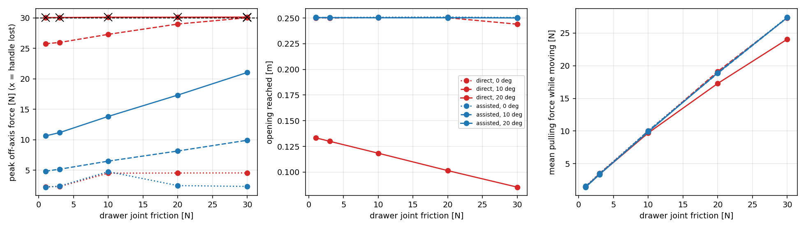
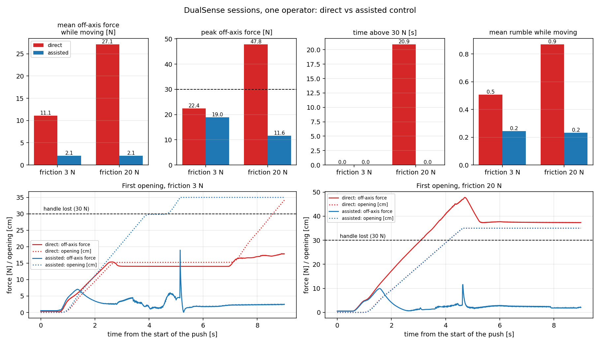
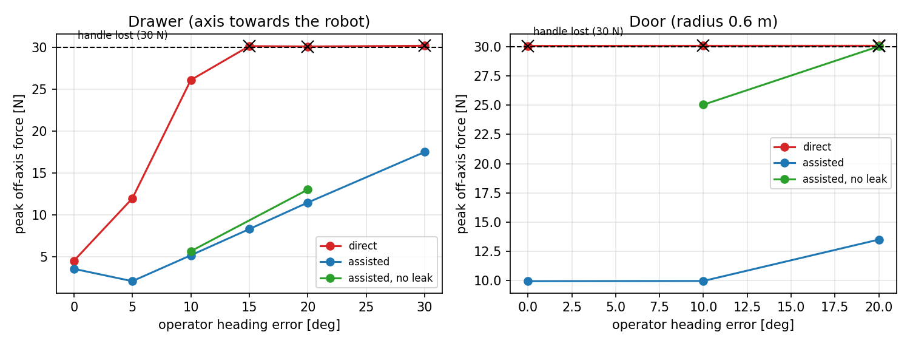

# Shared Control: Drive the Robot and Feel the Drawer (steps 4 to 8)

Phase 3 showed the problem: with plain direct control, a push that misses the drawer's direction by less than 1° loses the handle. This part adds the solution from the project paper:

1. **A soft (compliant) controller** (step 4). The robot behaves like a spring attached to the target point, so a small aiming error causes a small force, not a large one.
2. **The helper ("assisted" mode)** (step 5). The robot works out which way the drawer moves and quietly removes the sideways part of your command.
3. **Haptic feedback** (step 5). The DualSense rumbles when you push sideways and its R2 trigger gets stiffer when the drawer is hard to pull. Without a controller, the keyboard tool shows the same two values as bars.
4. **One launch command** for all of it (step 6), **experiments** comparing direct and assisted control (step 7), and **files for the real FR3** (step 8, not yet tested on hardware).

The project folder is `~/SCE_571_ws`. Everything runs inside the Docker container, as in [README_PHASE3.md](README_PHASE3.md).

---

## Quick start: drive it with the keyboard

### Terminal 1: simulation, controller and helper

```bash
# --- Terminal 1, on the computer ---
xhost +local:docker
cd ~/SCE_571_ws
docker compose up -d
docker compose exec dev bash
```

```bash
# --- Terminal 1, inside the container ---
source ~/SCE_571_ws/ros2_ws/install/setup.bash
ros2 launch sc_teleop teleop.launch.py
```

Gazebo opens with the robot holding the drawer handle. **Wait for this line** (about 15 s):

```
[shared_control]: READY: assisted control, joy operator, drawer ...
```

### Terminal 2: the keyboard

```bash
# --- Terminal 2, on the computer ---
cd ~/SCE_571_ws
docker compose exec dev bash
```

```bash
# --- Terminal 2, inside the container ---
source ~/SCE_571_ws/ros2_ws/install/setup.bash
python3 ~/SCE_571_ws/scripts/keyboard_joy.py
```

Keep Terminal 2 selected and press keys:

| Key | Does |
|---|---|
| `a` / `d` | Left stick left / right: hand along -x / +x |
| `w` / `s` | Left stick up / down: hand along +y / -y |
| `i` / `k` | Right stick up / down: hand up / down |
| `space` | R2 on / off. **Off = the robot stays still** |
| `1` … `9`, `0` | Speed with R2 on: 10 % … 90 %, `0` = 100 % (0.1 m/s) |
| `x` | Centre both sticks |
| `q` | Quit (releases R2 first) |

**Open the drawer:** press `a` four times, then `space`. The drawer slides open. Press `space` again to stop.

**Feel the helper:** press `x`, then `a a a a w w` (left and a bit sideways, about 27°), then `space`.
- In **assisted** mode (the default), the drawer still opens smoothly. The status line in Terminal 2 shows a little `rumble` because the robot is telling you that part of your command was removed.
- Now try the same in **direct** mode: stop Terminal 1 with `Ctrl+C`, run `bash ~/SCE_571_ws/scripts/stop_sim.sh`, and start it again with `ros2 launch sc_teleop teleop.launch.py mode:=direct`. The rumble bar fills up and Terminal 1 reports a large `off-axis` force.

Terminal 1 prints a line every second while you drive:

```
t   3.0 s  opening 0.120 m  off-axis   4.1 N  along   3.5 N  c 1.00  rumble 0.21  trigger 0.11
```

| Value | Meaning |
|---|---|
| `opening` | How far the drawer is open |
| `off-axis` | Sideways force on the handle (the bad one; 30 N would pull the handle out of a real gripper) |
| `along` | Force pulling the drawer open (about 3.5 N for this drawer) |
| `c` | How sure the robot is about the drawer's direction, 0 to 1 |
| `rumble` | Rumble strength the DualSense would give, 0 to 1 |
| `trigger` | R2 stiffness the DualSense would give, 0 to 1 |

**Reset** before the next run: `Ctrl+C` in Terminal 1, `bash ~/SCE_571_ws/scripts/stop_sim.sh`, launch again.

---

## With the PS5 DualSense controller

Plug the controller in by USB **before** starting the container (or restart it with `docker compose restart`). Then in Terminal 1:

```bash
# --- Terminal 1, inside the container ---
source ~/SCE_571_ws/ros2_ws/install/setup.bash
ros2 launch sc_teleop teleop.launch.py input:=dualsense
```

This starts the simulation, the helper, `joy_node` (reads the sticks) and `dualsense_haptics` (drives rumble and trigger). No second terminal is needed.

| Control | Action |
|---|---|
| **R2 trigger** | Speed and safety switch: released = robot stays still, fully pressed = 0.1 m/s |
| Left stick left / right | Hand along the robot's x axis (left = towards the robot = opens the drawer) |
| Left stick up / down | Hand along the robot's y axis |
| Right stick up / down | Hand up / down |
| **What you feel: rumble** | You are pushing sideways against the drawer, or the helper removed part of your command |
| **What you feel: R2 resistance** | The drawer is hard to pull; the harder it is, the stiffer the trigger |

Tested on 2026-11-25 with a DualSense on USB:
- `joy_node` opens it through the Linux kernel driver (`hid-playstation`) and publishes `/joy` at about 36 Hz, with the sticks and R2 in the order the code expects.
- `dualsense_haptics` connects through `pydualsense` and sends rumble and trigger commands.

The launch file sets `SDL_JOYSTICK_HIDAPI=0` for `joy_node`. Without it, SDL opens the controller through its own HID driver: the axes come in a different order (the right stick moves to axis 3), and SDL competes with `pydualsense` for the rumble and trigger channel. If `dualsense_haptics` prints `no DualSense found`, check that `/dev/hidraw*` exists inside the container; the udev rule from `setup_host_docker.sh` gives access without root. If a stick moves the wrong way, check the values with `ros2 topic echo /joy`.

---

## Recorded driving sessions (your own trials)

Every keyboard or DualSense run is recorded automatically. The easiest way to drive with the DualSense is one command in a **normal terminal** (not inside the container):

```bash
# --- on the computer ---
cd ~/SCE_571_ws
bash scripts/drive.sh assisted 3        # helper on, drawer friction 3 N
bash scripts/drive.sh direct 3          # helper off, same drawer
bash scripts/drive.sh assisted 20       # a stiffer drawer: 20 N of friction
bash scripts/drive.sh assisted 3 door   # the door instead of the drawer
bash scripts/drive.sh stop              # end the session (the recording is saved)
```

Each command first ends and saves the previous session, then starts a fresh simulation. Wait for `READY`, then drive. To watch the live numbers, run `docker exec sce571_dev tail -f /tmp/teleop.log`.

**What gets saved** in `results/sessions/<time>_<mode>_<mechanism>_f<friction>/` (the time is UTC, the container's clock):

| File | Content |
|---|---|
| `video.mp4` | The camera view with mode, friction, opening, off-axis force (against the 30 N line), rumble, R2 resistance and your speed drawn on it; a red `HANDLE WOULD BE LOST` banner when the force passes 30 N |
| `data.csv` | Every 10 ms: time, opening, off-axis force, pulling force, confidence c, rumble, trigger, your command and the command sent to the robot |
| `summary.json` | The settings, plus the results: furthest opening, time to reach 0.25 m, peak and mean off-axis force, time spent above 30 N and how often the force crossed it |

**Compare your sessions** after driving:

```bash
# --- on the computer ---
cd ~/SCE_571_ws
python3 scripts/analyze_sessions.py --h264
python3 scripts/make_session_figures.py
```

`make_session_figures.py` takes the latest direct and assisted session at each friction and makes comparison figures, plus a video and GIF of the camera next to a live force plot (`results/sessions/figures/`). `analyze_sessions.py` writes `results/sessions/sessions.md` (a table of every session, then direct vs assisted per friction), `sessions.png`, a `plot.png` in each session folder and, with `--h264`, a `video_h264.mp4` that plays in a browser. To put two or four sessions side by side in one video: `python3 scripts/make_grid_video.py out.mp4 <session dir> <session dir> ...`.

A suggested set of drives (the same task each time: open the drawer 0.25 m without the off-axis force passing 30 N):

| Friction | Direct | Assisted |
|---|---|---|
| 3 N | 3 runs | 3 runs |
| 20 N | 3 runs | 3 runs |

Alternate the modes (direct, assisted, direct, ...) so that practice does not favour one of them.

---

## Launch options

```bash
ros2 launch sc_teleop teleop.launch.py [options]
```

| Option | Values | Default |
|---|---|---|
| `mode` | `assisted` (helper on), `direct` (helper off) | `assisted` |
| `input` | `keyboard`, `dualsense`, `script` | `keyboard` |
| `kind` | `drawer`, `door` | `drawer` |
| `yaw` | direction of the mechanism; `3.14159` points at the robot, `2.74159` and `3.54159` are turned 0.4 rad | `3.14159` |
| `heading` | with `input:=script`: how far (degrees) the scripted operator's push misses the drawer's direction | `0.0` |
| `gui` | `false` runs without the Gazebo window | `true` |
| `friction` | friction between the drawer and its cabinet (or in the door hinge) [N or Nm] | `3.0` |
| `damping` | damping of the same joint [N·s/m] | `5.0` |
| `record` | `auto` records keyboard and DualSense runs; `true` or `false` | `auto` |
| `video` | `false` records only the data, not the video | `true` |
| `out`, `log` | with `input:=script`: save the result (JSON) and the time series (CSV) | none |

**Scripted trial**, the same as in the experiments:

```bash
ros2 launch sc_teleop teleop.launch.py input:=script mode:=direct heading:=20
```

It prints one result line with `"status": "success"` or `"handle_lost"`, then stops.

---

## How the controller works (easy version)

### Step 4: the robot as a spring

The controller computes the gripper's position error **e** (target minus actual, 6 numbers: 3 for position and 3 for rotation) and its velocity **ẋ**, and asks the joints for the torques

**τ = Jᵀ (K e − D ẋ) + null-space term**

- **K e** is a spring: 600 N/m. If the target is 1 cm away, the hand is pulled with 6 N.
- **D ẋ** is a damper (shock absorber): 50 N·s/m. It stops the spring from bouncing.
- **Jᵀ** (the transposed Jacobian) turns a force at the gripper into the 7 joint torques that produce it.
- **Null-space term:** the FR3 has 7 joints but the gripper only needs 6, so the elbow can move without moving the gripper. This term keeps the elbow near its start pose and pushes any joint away from its limit, without creating force at the gripper.
- **Safety limits:** the spring stretch is capped at 10 cm (at most 60 N), each torque changes by at most 1 Nm per millisecond, as on the real FR3, and every torque stays within the FR3's limits.

The difference from Phase 3: the old joint controller was **stiff** (a few millimetres of sideways error gave 30 N). The spring gives 600 N/m, so the same few millimetres give only 2 to 3 N.

### Why it is stable (Lyapunov, easy version)

Take the "energy" of the robot

**V = ½ q̇ᵀ M(q) q̇ + ½ eᵀ K e**

- The first part is the **kinetic energy** of the moving arm (M is its mass matrix).
- The second part is the **energy stored in the spring**.
- V is never negative, and it is zero only when the arm is still at the target.

Working out how V changes over time with this controller (and gravity compensated) gives

**dV/dt = − ẋᵀ D ẋ − (null-space damping) ≤ 0**

The damper can only **remove** energy, never add it. So the energy can only go down until the arm stops at the target: the controller is **stable**. This holds for any positive K and D, which makes tuning safe. When the gripper holds the drawer, the drawer's friction and damping also only remove energy (the drawer is "passive"), so the robot and drawer together stay stable as well. This is the classic result of Takegaki and Arimoto (1981) and of Hogan's impedance control (1985).

The argument has two limits: it treats the target as fixed (the operator moves it slowly, 0.1 m/s at most), and the joint-limit and elbow terms are only approximately in the analysis because they act through the null-space projection.

### Step 5: the helper (assisted mode)

Every 10 ms:

1. **Your command** u comes from the sticks: direction × trigger × 0.1 m/s.
2. **Direction estimate.** The robot watches how its gripper actually moves. The drawer only lets it move one way, so the average direction of motion is the drawer's direction **d̂**. The more consistent the motion, the higher the confidence **c** (0 to 1).
3. **Filtering.** Once c is high, the sideways part of u is cut to 5 %: v = (along part) + 0.05 × (sideways part). With c low (at the start), your command passes unchanged.
4. **Leak.** Sideways error that was built up before the helper engaged slowly fades (2 per second), so it doesn't keep pressing on the handle.
5. **Target update:** the spring's target point moves by v × 10 ms.
6. **Haptics:** rumble from the sideways force and the removed command; trigger stiffness from the pulling force.

In **direct** mode, steps 2 to 4 are skipped: the target follows your command exactly, as in Phase 3, but now with the soft controller.

---

## Results (step 7)

46 scripted trials compared direct and assisted control with the new soft controller. The scripted operator pushes at a fixed angle away from the drawer's direction and never corrects.

| | Direct | Assisted |
|---|---|---|
| Trials that opened the drawer or door | **10 of 21** | **21 of 21** |
| Drawer, 10° off: highest sideways force | 26 N | 5 N |
| Drawer, 20° off | handle lost at 0.13 m | opened, highest 11 N |
| Drawer, 30° off | handle lost at 0.08 m | opened, highest 18 N |
| Door, aimed straight | handle lost at 0.21 m | opened, highest 10 N |

For comparison, Phase 3's stiff controller lost the handle from 0.75° off.

**Friction study.** 30 more scripted trials varied the drawer's friction from 1 N to 30 N, at heading errors of 0°, 10° and 20°. Each trial was video-recorded ([results/friction/](results/friction/)).

| Friction | Direct, 20° off | Assisted, 20° off | Direct, 10° off | Assisted, 10° off |
|---|---|---|---|---|
| 1 N | handle lost at 0.13 m | opened, peak 10.6 N | opened, peak 25.8 N | opened, peak 4.8 N |
| 3 N | lost at 0.13 m | opened, 11.2 N | opened, 26.0 N | opened, 5.2 N |
| 10 N | lost at 0.12 m | opened, 13.8 N | opened, 27.3 N | opened, 6.5 N |
| 20 N | lost at 0.10 m | opened, 17.3 N | opened, 29.0 N | opened, 8.1 N |
| 30 N | lost at 0.09 m | opened, 21.0 N | lost at 0.24 m | opened, 9.9 N |

Assisted control opened the drawer in 15 of 15 trials, direct in 9 of 15. A stiffer drawer makes both modes worse. The spring has to stretch further before the drawer starts to move (friction ÷ 600 N/m, 5 cm at 30 N), and during that time the sideways error grows. In assisted mode the peak comes from the first second, before the helper is confident. The pulling force rises with friction exactly as set (1.5 N at 1 N friction, 27 N at 30 N).

Side by side at 20° off: direct (left) and assisted (right), friction 1 N (top) and 30 N (bottom): `results/friction/friction_h20_comparison.mp4` (made locally by the study, not in the repository).



**Your first DualSense sessions** (one each of direct and assisted, at 3 N and 20 N): the mean off-axis force while moving was 2.1 N assisted against 11.1 N (3 N) and 27.1 N (20 N) direct, and only direct control at 20 N lost the handle. Details, figures and the caveats are in [README.md §7.6](README.md#76-friction-study-and-recorded-sessions).



**Haptics finding:** the R2 resistance uses a fixed scale from 2 N to 15 N of pulling force. At 1 N friction the trigger stays at 0, and from 20 N it is always at 1, so it can no longer tell a stiff drawer from a jammed one. The scale should be tuned from your drives (see the next steps in [README.md](README.md#12-objectives-check-and-next-steps)).



See [results/step7/summary.md](results/step7/summary.md) for every trial condition, and [results/step7/peak_force.png](results/step7/peak_force.png) and [results/step7/traces.png](results/step7/traces.png) for the plots. The section **7.5** in [README.md](README.md#75-step-7-direct-vs-assisted-with-the-impedance-controller) summarises them.

Repeat the experiments (about an hour; the container must be running, the simulation must not):

```bash
# --- on the computer ---
cd ~/SCE_571_ws
bash scripts/run_experiments.sh
python3 scripts/analyze_step7.py
```

---

## Real FR3 (step 8, not tested on hardware)

The same controller and helper run on the real robot with `franka_ros2`. Nothing in this section has been run on a robot yet.

**Before the first run:**
1. Robot PC with a **PREEMPT_RT** kernel. Build `libfranka` and `franka_ros2` versions that match the robot's system image (check in Desk) into `ros2_ws/src`.
2. Enable FCI in Desk, keep the **user stop** in your hand, and clear the workspace.
3. Fix the drawer or door, and close the gripper on its handle by hand (Desk or `franka_gripper`) before starting the controller.

**Run:**

```bash
# terminal 1: franka_ros2 driver and controller manager
ros2 launch franka_bringup franka.launch.py robot_ip:=<FR3 IP> arm_id:=fr3 load_gripper:=true
# terminal 2: impedance controller, wrench relay, helper, DualSense
ros2 launch sc_teleop hardware.launch.py mode:=assisted
```

**Differences from the simulation** ([config/fr3_hardware.yaml](ros2_ws/src/sc_teleop/config/fr3_hardware.yaml)):
- **Softer and slower to start:** 400 N/m, 20 Nm/rad, spring stretch capped at 5 cm, top speed 0.05 m/s.
- **No gravity term:** libfranka compensates gravity itself.
- **Force from the robot's own estimate:** the handle force comes from Franka's external-wrench estimate `O_F_ext_hat_K` through `franka_wrench_relay`, with its sign flipped, because the estimate is the force on the robot.
- **No ground truth:** "opening" is the distance the gripper has travelled, and there's no automatic trial end. Stop with R2 or the user stop.

---

## If something goes wrong

| Problem | Fix |
|---|---|
| `READY` never appears | Wait for `simulation ready`; if it doesn't come, run `bash ~/SCE_571_ws/scripts/stop_sim.sh` and launch again |
| Keys do nothing | Click Terminal 2, check its line says `trial listening` and that R2 is ON |
| `could not switch to the impedance controller` | Rebuild: `cd ~/SCE_571_ws/ros2_ws && colcon build --symlink-install`, then launch again |
| The drawer stops near 0.20 m with a large force | The drawer is too close to the robot (`x:=0.7`): the elbow folds to its limit. Use the default `x` (0.8 m for the drawer) |
| `no DualSense found` | Plug it in before `docker compose up`, or run `docker compose restart` |
